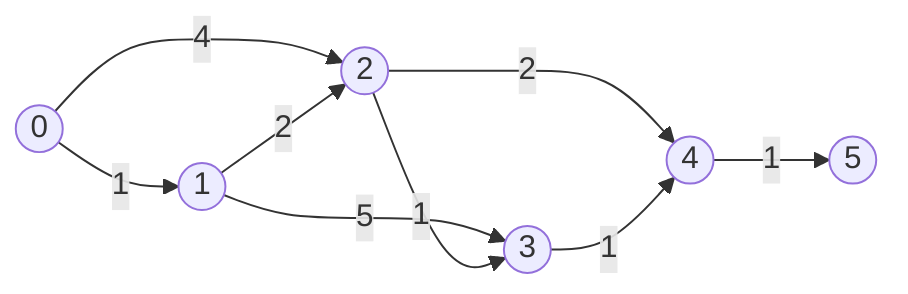
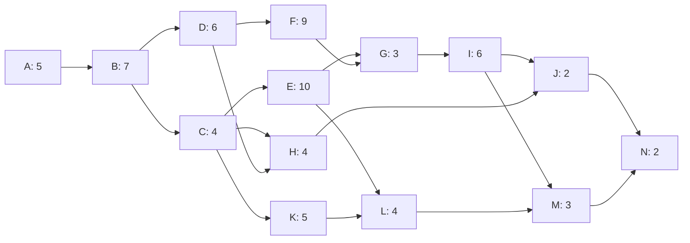
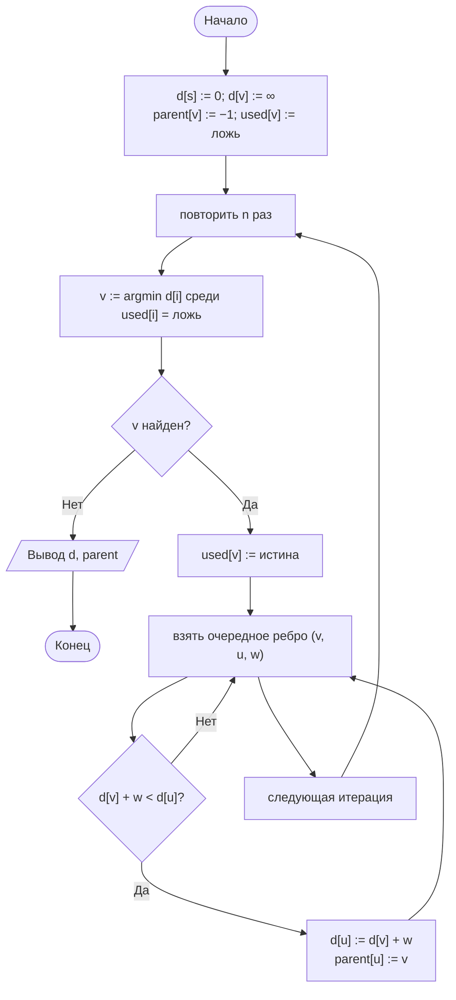
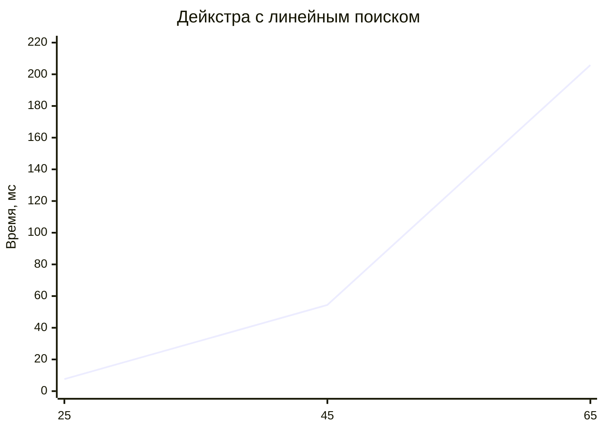
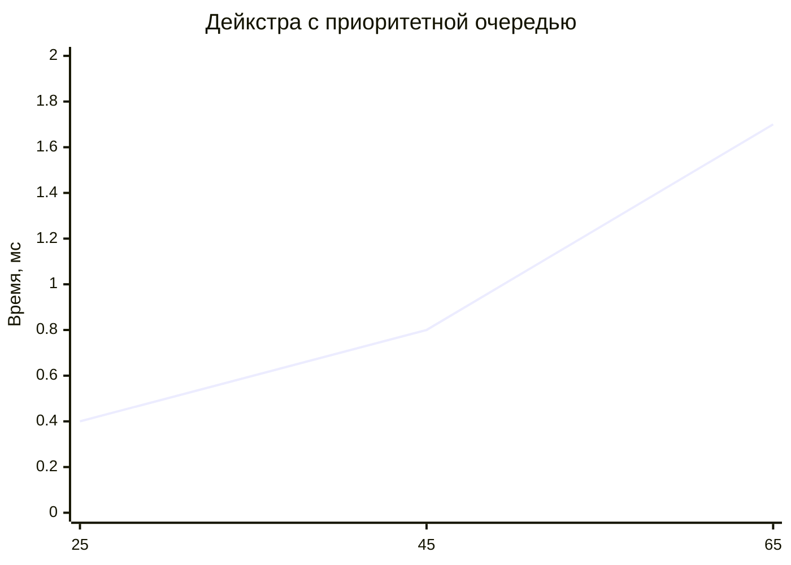

# Лабораторная работа № 10

## Алгоритмы поиска кратчайших путей и расчёт критического пути сетевого графика

**Вариант 11**
**Дисциплина:** Теория алгоритмов
**Язык реализации:** Python 3.14

---

## 1. Цель и задание варианта

**Цель:** реализовать алгоритм Дейкстры с линейным поиском минимума и с приоритетной очередью, сравнить их на сеточных графах и применить топологическую сортировку для расчёта критического пути проекта.

**Исходные данные (табл. 1, вариант 11):**

| Параметр | Значение |
|---|---|
| Граф для Дейкстры | Решётка $k \times k$ |
| Размеры | $k = 25; 45; 65$ |
| Веса рёбер | 1…50 |
| Число работ в проекте | 14 |
| Дополнительное задание | К4 |

**Задание К4:** находить не только длину кратчайшего пути, но и число кратчайших путей между двумя вершинами.

---

## 2. Теоретическая часть

### 2.1. Задача о кратчайших путях

Дан взвешенный граф $G=(V,E)$ с неотрицательными весами. Требуется найти путь минимальной длины из вершины $s$ в остальные вершины. Любой подпуть кратчайшего пути сам является кратчайшим — это свойство оптимальной подструктуры.

| Алгоритм | Трудоёмкость | Ограничение |
|---|---|---|
| Дейкстры с массивом | $\Theta(n^2)$ | Веса $\ge 0$ |
| Дейкстры с кучей | $O(m\log n)$ | Веса $\ge 0$ |
| Беллмана — Форда | $\Theta(nm)$ | Нет отрицательных циклов |
| Флойда — Уоршелла | $\Theta(n^3)$ | Нет отрицательных циклов |

### 2.2. Алгоритм Дейкстры

Поддерживается массив оценок $d[v]$. На каждом шаге выбирается непросмотренная вершина с минимальным $d[v]$, после чего выполняется релаксация её исходящих рёбер:

$$d[u]=\min\bigl(d[u],\ d[v]+w(v,u)\bigr).$$

При улучшении $d[u]$ запоминается предок `parent[u] = v`, что позволяет восстановить путь.

**Две реализации:**

- **массив** — минимум ищется линейным просмотром за $\Theta(n)$, итого $\Theta(n^2)$;
- **куча** — минимум извлекается за $O(\log n)$, итого $O(m\log n)$.

Куча выгодна на разреженных графах, массив — на плотных, где $m\approx n^2$.

### 2.3. Число кратчайших путей (К4)

Вместе с расстоянием хранится массив `count[v]` — число кратчайших путей из $s$ в $v$.

- при улучшении $d[u]$: `count[u] = count[v]`;
- при равенстве $d[v]+w=d[u]$: `count[u] += count[v]`.

Так как веса положительны, все предшественники вершины на кратчайшем пути обрабатываются раньше неё, поэтому счётчик успевает накопить все варианты.

### 2.4. Топологическая сортировка и критический путь

**Алгоритм Кана** использует входящие степени: сначала в очередь попадают вершины с нулевой степенью, затем при удалении вершины степени её потомков уменьшаются. Если обработано меньше $n$ вершин, в графе есть цикл.

Для сетевого графика проекта:

$$ES_i=\max_{j\in\text{Pred}(i)} EF_j,\qquad EF_i=ES_i+t_i,$$

$$LF_i=\min_{j\in\text{Succ}(i)} LS_j,\qquad LS_i=LF_i-t_i.$$

Полный резерв работы:

$$R_i=LS_i-ES_i=LF_i-EF_i.$$

Работы с $R_i=0$ образуют критический путь: их задержка увеличивает срок всего проекта.

---

## 3. Тестовый граф и ручной расчёт



Расчёт от вершины 0:

| Вершина | 0 | 1 | 2 | 3 | 4 | 5 |
|---|---|---|---|---|---|---|
| $d[v]$ | 0 | 1 | 3 | 4 | 5 | 6 |
| Число путей | 1 | 1 | 1 | 1 | 2 | 2 |

- $d[2]=\min(4,\ 1+2)=3$ — путь через вершину 1;
- $d[3]=\min(1+5,\ 3+1)=4$ — путь через вершину 2;
- $d[4]=\min(3+2,\ 4+1)=5$ — два равных варианта;
- $d[5]=5+1=6$ — оба пути до вершины 4 продолжаются в 5.

Восстановленный путь: $0\to1\to2\to4\to5$, длина 6. Второй кратчайший путь: $0\to1\to2\to3\to4\to5$, тоже длина 6. Их количество для вершины 5 равно 2.

---

## 4. Сетевой график проекта



В проекте 14 работ. Ветвь $C\to E\to L$ и ветвь $D\to F\to G$ идут параллельно, а работы $J$ и $M$ сходятся в финальной работе $N$.

---

## 5. Блок-схема алгоритма Дейкстры



---

## 6. Листинг программы и пояснение работы кода

Полный код находится в файле [`lab10.py`](lab10.py). Ключевые функции:

```python
def dijkstra_array(adj, s):
    n = len(adj)
    dist = [INF] * n
    parent = [-1] * n
    used = [False] * n
    dist[s] = 0
    for _ in range(n):
        v, best = -1, INF
        for i in range(n):                 # линейный поиск минимума
            if not used[i] and dist[i] < best:
                v, best = i, dist[i]
        if v == -1:
            break
        used[v] = True
        for u, w in adj[v]:
            if dist[v] + w < dist[u]:
                dist[u] = dist[v] + w
                parent[u] = v
    return dist, parent


def dijkstra_heap(adj, s):
    n = len(adj)
    dist = [INF] * n
    parent = [-1] * n
    dist[s] = 0
    heap = [(0, s)]
    while heap:
        d, v = heapq.heappop(heap)
        if d > dist[v]:
            continue                       # устаревшая запись
        for u, w in adj[v]:
            if d + w < dist[u]:
                dist[u] = d + w
                parent[u] = v
                heapq.heappush(heap, (dist[u], u))
    return dist, parent


def dijkstra_count(adj, s):
    dist = [INF] * len(adj)
    count = [0] * len(adj)
    parent = [-1] * len(adj)
    dist[s], count[s] = 0, 1
    heap = [(0, s)]
    while heap:
        d, v = heapq.heappop(heap)
        if d > dist[v]:
            continue
        for u, w in adj[v]:
            if d + w < dist[u]:
                dist[u] = d + w
                count[u] = count[v]
                parent[u] = v
                heapq.heappush(heap, (dist[u], u))
            elif d + w == dist[u]:
                count[u] += count[v]       # ещё один кратчайший путь
    return dist, count, parent
```

### 6.1. Как работает программа в целом

1. **`dijkstra_array`** — классическая реализация с массивом `used` и линейным поиском минимума.
2. **`dijkstra_heap`** — реализация с `heapq`; устаревшие записи пропускаются.
3. **`dijkstra_count`** — та же куча, но дополнительно хранит число кратчайших путей (К4).
4. **`restore_path`** — идёт по `parent` от цели к источнику и переворачивает список.
5. **`grid_graph`** — строит неориентированную сетку $k\times k$ с весами 1…50; каждое ребро хранится в обе стороны.
6. **`topological_order`** — алгоритм Кана, при цикле выбрасывает исключение.
7. **`critical_path`** — прямой и обратный проходы, резервы и список критических работ.

---

## 7. Характеристики вычислительной системы

| Параметр | Значение |
|---|---|
| ОС | macOS 26.4 (Darwin 25.4.0, arm64) |
| Процессор | Apple M5 |
| Оперативная память | 16 ГБ |
| Интерпретатор | Python 3.14.7 |

Методика замера: `time.perf_counter()`, один запуск каждой реализации на одном и том же графе. Результаты расстояний обеих реализаций проверяются через `assert`.

---

## 8. Результаты

### 8.1. Две реализации алгоритма Дейкстры

Сетка $k\times k$, веса 1…50. $m$ — число направленных дуг.

| $k$ | $n=k^2$ | $m$ | Массив, с | Куча, с | Массив / куча | $d$ до угла | Кратчайших путей | Вершин в пути |
|---|---|---|---|---|---|---|---|---|
| 25 | 625 | 2 400 | 0,0076 | 0,0004 | 21,5 | 624 | 1 | 49 |
| 45 | 2 025 | 7 920 | 0,0544 | 0,0008 | 68,8 | 1173 | 3 | 89 |
| 65 | 4 225 | 16 640 | 0,2058 | 0,0017 | 118,7 | 1572 | 1 | 133 |

Реализация с кучей быстрее в 21–119 раз, причём разрыв растёт с размером графа. Время массива растёт примерно как $n^2$: при переходе от $n=625$ к $n=2025$ (в 3,24 раза) оно выросло в 7,2 раза, а при переходе от 2025 к 4225 (в 2,09 раза) — в 3,8 раза. Куча обрабатывает только существующие дуги, поэтому для разреженной сетки работает за $O(m\log n)$.





### 8.2. Задание К4 — число кратчайших путей

Для пары «левый верхний угол — правый нижний угол» получены значения 1, 3 и 1. При случайных весах 1…50 равные по сумме маршруты встречаются редко, поэтому число путей невелико. На малом тестовом графе таких путей два, и это хорошо видно при ручном расчёте.

Алгоритм хранит счётчик вместе с расстоянием: при улучшении он заменяется, при равенстве — складывается. Поэтому после завершения обхода `count[t]` содержит точное число кратчайших путей.

### 8.3. Расчёт критического пути проекта

| Работа | $t$ | $ES$ | $EF$ | $LS$ | $LF$ | Резерв $R$ | Критическая |
|---|---|---|---|---|---|---|---|
| A | 5 | 0 | 5 | 0 | 5 | 0 | да |
| B | 7 | 5 | 12 | 5 | 12 | 0 | да |
| C | 4 | 12 | 16 | 13 | 17 | 1 | |
| D | 6 | 12 | 18 | 12 | 18 | 0 | да |
| E | 10 | 16 | 26 | 17 | 27 | 1 | |
| F | 9 | 18 | 27 | 18 | 27 | 0 | да |
| G | 3 | 27 | 30 | 27 | 30 | 0 | да |
| H | 4 | 18 | 22 | 33 | 37 | 15 | |
| I | 6 | 30 | 36 | 30 | 36 | 0 | да |
| J | 2 | 36 | 38 | 37 | 39 | 1 | |
| K | 5 | 16 | 21 | 27 | 32 | 11 | |
| L | 4 | 26 | 30 | 32 | 36 | 6 | |
| M | 3 | 36 | 39 | 36 | 39 | 0 | да |
| N | 2 | 39 | 41 | 39 | 41 | 0 | да |

**Длительность проекта: 41 день.**
**Критический путь: A → B → D → F → G → I → M → N.**

Работы C, E и J имеют резерв всего 1 день: их задержка более чем на день меняет критический путь. Работа H может сдвигаться в пределах 15 дней, K — 11 дней, L — 6 дней. Эти работы можно использовать как резерв для перераспределения ресурсов.

---

## 9. Выводы

1. Реализация Дейкстры с приоритетной очередью на сеточных графах оказалась в 21–119 раз быстрее реализации с линейным поиском. Разрыв растёт с $n$, потому что массив тратит $\Theta(n^2)$ на поиск минимума, а куча — $O(m\log n)$ и обрабатывает только реальные дуги.

2. Обе реализации дали одинаковые расстояния на всех графах, что подтверждает корректность обеих. Различие только в трудоёмкости.

3. Восстановление пути по массиву предков работает за $O(\text{длина пути})$ и не требует хранения самих путей. На малом графе восстановлен путь $0\to1\to2\to4\to5$ длины 6.

4. Задание К4 реализовано через дополнительный массив `count`. При улучшении расстояния счётчик заменяется, при равенстве — складывается. На малом графе найдено два кратчайших пути, на сетках — от 1 до 3.

5. Метод критического пути выполняется за два прохода в топологическом порядке, то есть за $\Theta(n+m)$. Для проекта из 14 работ длительность составила 41 день, критический путь — A → B → D → F → G → I → M → N.

6. Работы вне критического пути имеют положительный резерв. Это позволяет сдвигать их без увеличения срока проекта. Наибольший резерв у работы H (15 дней), наименьший ненулевой — у C, E и J (по 1 дню); именно они первыми станут критическими при задержке.

7. Практическая рекомендация: для разреженных графов использовать Дейкстру с кучей, для плотных — массив; критический путь считать через топологическую сортировку, а не полным перебором путей.
