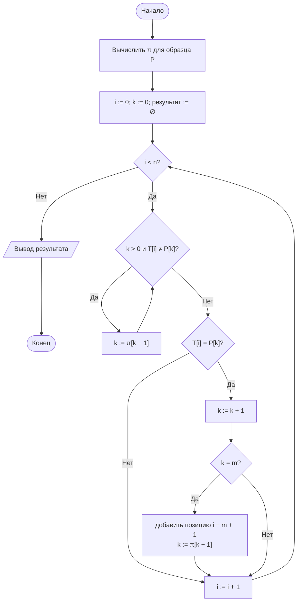
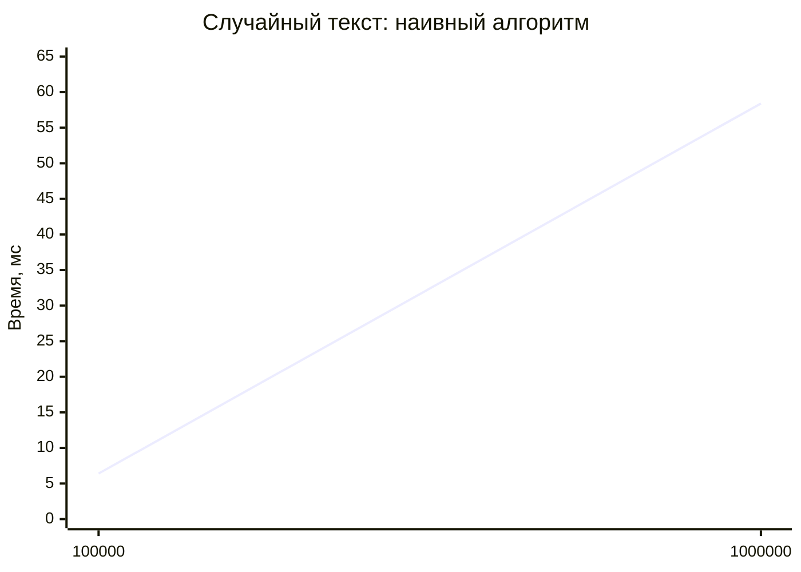
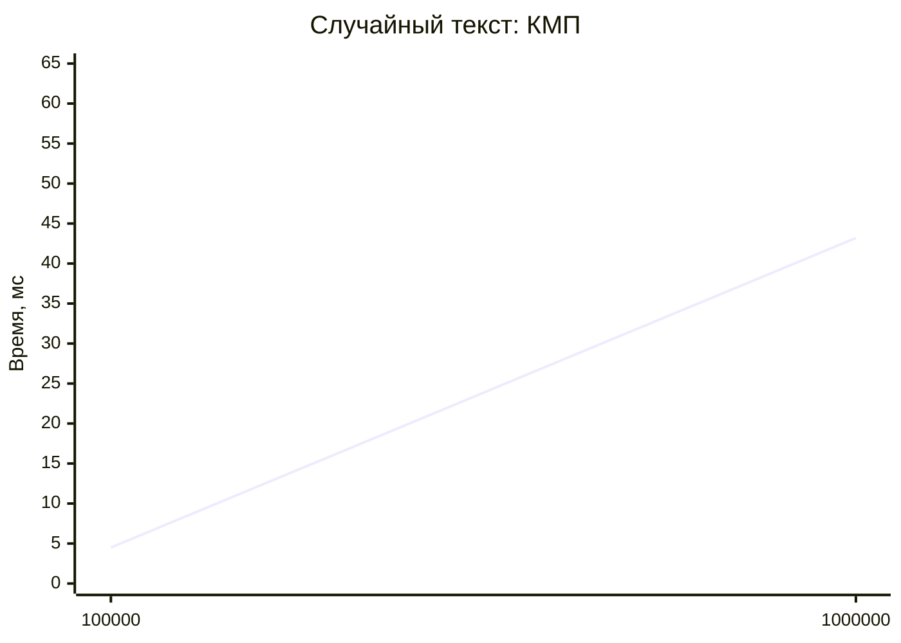
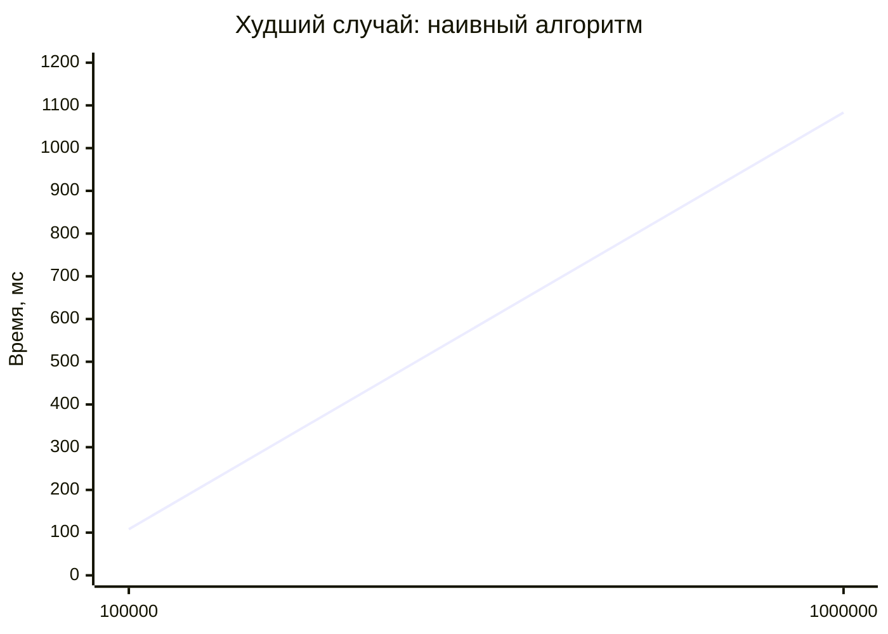
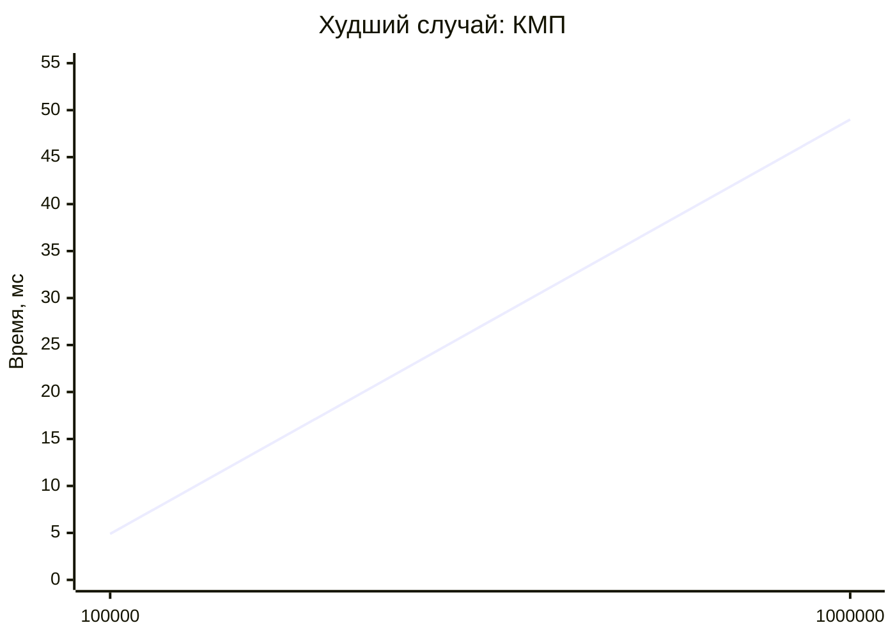
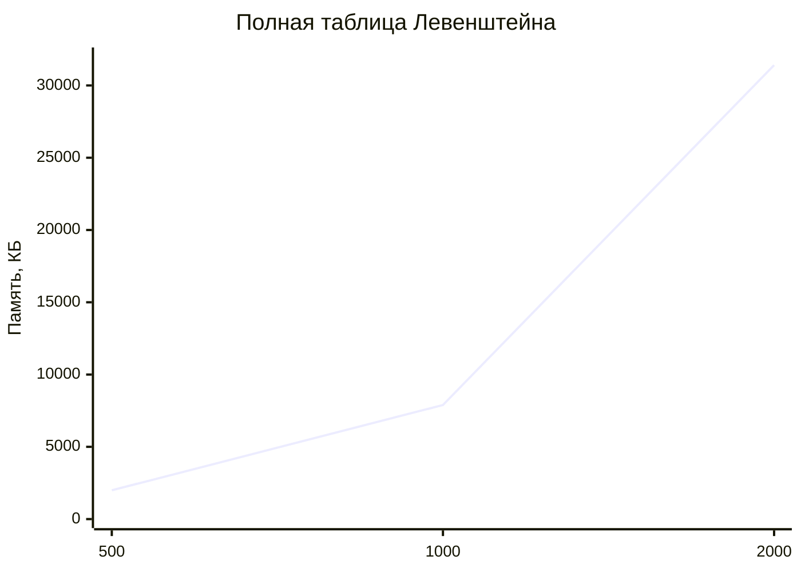

# Лабораторная работа № 11

## Алгоритмы поиска подстроки и вычисления редакционного расстояния

**Вариант 11**
**Дисциплина:** Теория алгоритмов
**Язык реализации:** Python 3.14

---

## 1. Цель и задание варианта

**Цель:** изучить наивный алгоритм поиска подстроки и алгоритм Кнута — Морриса — Пратта, реализовать расстояние Левенштейна и применить эти алгоритмы к сопоставлению наименований контрагентов.

**Исходные данные (табл. 1, вариант 11):**

| Параметр | Значение |
|---|---|
| Образец для ручного расчёта $\pi$ | `abbabba` |
| Тип текста | Случайный |
| Длины текста $n$ | $10^5$; $10^6$ |
| Порог сходства | 0,80 |
| Дополнительное задание | Л4 |

**Задание Л4:** реализовать расстояние Левенштейна с $\Theta(\min(n,m))$ памяти и сравнить время и расход памяти с полной таблицей.

Дополнительно в работе проверен худший случай наивного алгоритма на тексте из одинаковых символов. Вариант задаёт только случайный текст, но без такого опыта нельзя увидеть разницу между $\Theta(nm)$ и $\Theta(n+m)$: на случайных данных оба алгоритма работают почти одинаково.

---

## 2. Теоретическая часть

### 2.1. Задача поиска подстроки

Даны текст $T$ длиной $n$ и образец $P$ длиной $m \le n$. Нужно найти все позиции $i$, где $T[i..i+m-1]=P$. Задача встречается при поиске по документам, фильтрации журналов, разборе форматов и проверке регулярных выражений.

### 2.2. Наивный алгоритм

Образец прикладывается к каждой позиции текста, после чего выполняется посимвольное сравнение. Если символы не совпали, образец сдвигается на одну позицию вправо, и сравнение начинается заново.

$$T_{\text{худш}}(n,m)=\Theta\bigl((n-m+1)\cdot m\bigr)=\Theta(nm).$$

На случайном тексте несовпадение обычно возникает уже на первых символах, поэтому среднее число сравнений близко к $\Theta(n)$. Худший случай — текст из одинаковых символов и образец, который совпадает почти до конца, например $T=a^n$ и $P=a^{m-1}b$.

### 2.3. Алгоритм Кнута — Морриса — Пратта

КМП не возвращает указатель по тексту назад. При несовпадении образец сдвигается по заранее вычисленной префикс-функции.

**Префикс-функция.** $\pi[i]$ — длина наибольшего собственного префикса подстроки $P[0..i]$, который одновременно является её суффиксом. «Собственный» означает, что префикс не равен всей подстроке.

Пример для $P=\text{«abcabd»}$:

| $i$ | 0 | 1 | 2 | 3 | 4 | 5 |
|---|---|---|---|---|---|---|
| $P[i]$ | a | b | c | a | b | d |
| $\pi[i]$ | 0 | 0 | 0 | 1 | 2 | 0 |

Смысл: если совпали пять символов «abcab», а шестой не совпал, то первые два символа «ab» уже гарантированно совпадают с концом просмотренного участка. Поэтому сравнение продолжается с третьего символа образца, а текст назад не перечитывается.

| Алгоритм | Предобработка | Поиск | Худший случай |
|---|---|---|---|
| Наивный | нет | — | $\Theta(nm)$ |
| Кнута — Морриса — Пратта | $\Theta(m)$ | $\Theta(n)$ | $\Theta(n+m)$ |

Оценка $\Theta(n+m)$ следует из того, что величина $k$ (число совпавших символов) увеличивается не более $n$ раз, а при каждом несовпадении уменьшается; суммарное число возвратов по $\pi$ не превосходит числа увеличений.

### 2.4. Расстояние Левенштейна

$d(A,B)$ — минимальное число операций вставки, удаления и замены символа, переводящих $A$ в $B$. Пусть $D[i][j]$ — расстояние между префиксами $A[0..i-1]$ и $B[0..j-1]$. Тогда

$$D[i][j]=\min\begin{cases}D[i-1][j]+1 & \text{(удаление)},\\ D[i][j-1]+1 & \text{(вставка)},\\ D[i-1][j-1]+c_{ij} & \text{(замена)},\end{cases}$$

где $c_{ij}=0$ при $A[i-1]=B[j-1]$ и $c_{ij}=1$ иначе. Граничные условия: $D[i][0]=i$, $D[0][j]=j$.

Время заполнения таблицы — $\Theta(nm)$. Полная таблица требует $\Theta(nm)$ памяти, но позволяет восстановить последовательность операций обратным проходом. Если хранить только две строки таблицы, память сокращается до $\Theta(\min(n,m))$, однако восстановить сами операции уже нельзя.

**Нормированное сходство:**

$$\text{sim}(A,B)=1-\frac{d(A,B)}{\max(|A|,|B|)}\in[0;1].$$

Нормировка нужна, чтобы расстояние можно было сравнивать для пар разной длины: одна вставка в слово из трёх букв и в слово из двадцати букв имеет разный вес.

### 2.5. Нечёткое сопоставление записей

Две информационные системы хранят одни и те же наименования по-разному. Порядок обработки:

1. **Нормализация:** нижний регистр, замена «ё» на «е», удаление кавычек, пунктуации и дефисов, удаление организационно-правовых форм (ООО, АО, ПАО, ИП), сжатие пробелов.
2. **Точное сопоставление** нормализованных строк.
3. **Нечёткое сопоставление** остатка по расстоянию Левенштейна с порогом сходства.

Прямое сравнение «каждый с каждым» имеет трудоёмкость $\Theta(N^2L^2)$, где $N$ — число записей, $L$ — средняя длина. При больших $N$ применяют блокирование кандидатов по первой букве или длине строки.

---

## 3. Ручной расчёт префикс-функции для образца `abbabba`

| Шаг | Подстрока | Наибольший собственный префикс, равный суффиксу | $\pi$ |
|---|---|---|---|
| 1 | a | нет | 0 |
| 2 | ab | нет | 0 |
| 3 | abb | нет | 0 |
| 4 | abba | «a» | 1 |
| 5 | abbab | «ab» | 2 |
| 6 | abbabb | «abb» | 3 |
| 7 | abbabba | «abba» | 4 |

Результат вручную: $\pi=[0,0,0,1,2,3,4]$. Программа выдаёт то же значение:

```
π для abbabba : [0, 0, 0, 1, 2, 3, 4]
```

Проверка шага 6: у строки «abbabb» префикс «abb» совпадает с суффиксом «abb», длина 3. На шаге 7 добавляется символ «a», и совпадение расширяется до «abba» длиной 4.

---

## 4. Блок-схема алгоритма КМП



---

## 5. Фрагмент таблицы редакционного расстояния

Пары «кот» и «скот»:

| | ∅ | с | к | о | т |
|---|---|---|---|---|---|
| **∅** | 0 | 1 | 2 | 3 | 4 |
| **к** | 1 | 1 | 1 | 2 | 3 |
| **о** | 2 | 2 | 2 | 1 | 2 |
| **т** | 3 | 3 | 3 | 2 | 1 |

Ответ $d=1$: достаточно вставить «с» в начало слова «кот». Диагональ таблицы показывает совпадение символов «к», «о», «т», поэтому замена не требуется.

Для пары «Ромашка» — «Ромашки» расстояние тоже равно 1 (замена последней буквы), сходство $1-1/7=0{,}857$.

---

## 6. Листинг программы и пояснение работы кода

Полный код находится в файле [`lab11.py`](lab11.py). Ключевые функции:

```python
def naive_search(text, pattern):
    n, m = len(text), len(pattern)
    positions, comparisons = [], 0
    for i in range(n - m + 1):
        j = 0
        while j < m:
            comparisons += 1
            if text[i + j] != pattern[j]:
                break
            j += 1
        if j == m:
            positions.append(i)
    return positions, comparisons


def prefix_function(pattern):
    pi = [0] * len(pattern)
    k = 0
    for i in range(1, len(pattern)):
        while k > 0 and pattern[i] != pattern[k]:
            k = pi[k - 1]
        if pattern[i] == pattern[k]:
            k += 1
        pi[i] = k
    return pi


def kmp_search(text, pattern):
    n, m = len(text), len(pattern)
    pi = prefix_function(pattern)
    positions, comparisons = [], 0
    k = 0
    for i in range(n):
        while k > 0 and text[i] != pattern[k]:
            comparisons += 1
            k = pi[k - 1]
        comparisons += 1
        if text[i] == pattern[k]:
            k += 1
        if k == m:
            positions.append(i - m + 1)
            k = pi[k - 1]
    return positions, comparisons


def levenshtein(a, b):
    if len(a) < len(b):
        a, b = b, a
    prev = list(range(len(b) + 1))
    for i, ca in enumerate(a, 1):
        cur = [i] + [0] * len(b)
        for j, cb in enumerate(b, 1):
            cur[j] = min(prev[j] + 1,                  # удаление
                         cur[j - 1] + 1,               # вставка
                         prev[j - 1] + (ca != cb))     # замена
        prev = cur
    return prev[-1]


def normalize(name):
    s = name.lower().replace("ё", "е")
    s = re.sub(r"[\"'«»„“”.,()-]", " ", s)
    return " ".join(w for w in s.split() if w not in LEGAL_FORMS)


def match_records(list_a, list_b, threshold=0.8):
    norm_b = [(b, normalize(b)) for b in list_b]
    result = []
    for a in list_a:
        na = normalize(a)
        best, best_sim, kind = None, 0.0, "не найдено"
        for b, nb in norm_b:
            if na == nb:
                best, best_sim, kind = b, 1.0, "точное"
                break
            s = similarity(na, nb)
            if s > best_sim:
                best, best_sim, kind = b, s, "нечёткое"
        if best_sim >= threshold:
            result.append((a, best, best_sim, kind))
        else:
            result.append((a, None, best_sim, "не найдено"))
    return result
```

### 6.1. Как работает программа в целом

1. **`naive_search`** перебирает все позиции текста и сравнивает символы, пока не встретится несовпадение. Дополнительно считает число сравнений, чтобы оценка сложности подтверждалась не только временем.
2. **`prefix_function`** заполняет массив $\pi$ за $\Theta(m)$: при несовпадении $k$ уменьшается по уже вычисленным значениям, поэтому цикл `while` в сумме выполняется не более $m$ раз.
3. **`kmp_search`** использует ту же логику, но по тексту. После полного совпадения $k$ уменьшается до $\pi[k-1]$, чтобы найти вхождения, которые могут перекрываться.
4. **`levenshtein`** хранит только предыдущую и текущую строки таблицы. Аргументы меняются местами так, чтобы короткая строка была второй, поэтому память равна $\Theta(\min(|a|,|b|))$.
5. **`levenshtein_full`** строит полную таблицу — она нужна для фрагмента отчёта и для замера памяти в задании Л4.
6. **`similarity`** переводит расстояние в сходство по формуле из п. 2.4.
7. **`normalize`** приводит наименование к единому виду: убирает кавычки, точки, запятые, скобки и дефисы, а также организационно-правовые формы.
8. **`match_records`** сначала пытается найти точное совпадение нормализованных строк и только потом считает расстояние Левенштейна. Если лучшее сходство ниже порога, запись считается ненайденной.

---

## 7. Характеристики вычислительной системы

| Параметр | Значение |
|---|---|
| ОС | macOS 26.4 (Darwin 25.4.0, arm64) |
| Процессор | Apple M5 |
| Оперативная память | 16 ГБ |
| Интерпретатор | Python 3.14.7 |

Методика замера: `time.perf_counter()`, один запуск каждого алгоритма на одном и том же тексте. Совпадение найденных позиций проверяется через `assert`. Память таблицы считается как сумма `sys.getsizeof` для списка строк и самих строк, без учёта общих объектов `int`.

---

## 8. Результаты

### 8.1. Сравнение наивного алгоритма и КМП

Образец `abbabba`, случайный текст из символов `a` и `b`.

| $n$ | Наивный, с | КМП, с | Сравнений (наивный) | Сравнений (КМП) | Вхождений |
|---|---|---|---|---|---|
| 100 000 | 0,0064 | 0,0045 | 198 653 | 149 251 | 810 |
| 1 000 000 | 0,0584 | 0,0432 | 1 983 915 | 1 491 630 | 7 901 |





На случайном тексте КМП быстрее примерно в 1,4 раза, но принципиального разрыва нет. Причина в том, что несовпадение возникает на первых символах: наивный алгоритм делает около двух сравнений на позицию, а КМП — около полутора. Число вхождений хорошо согласуется с теорией: при алфавите из двух букв вероятность совпадения образца длиной 7 равна $2^{-7}$, поэтому на $10^6$ символов ожидается около 7 812 вхождений, а получено 7 901.

При увеличении $n$ в 10 раз число сравнений у обоих алгоритмов выросло ровно в 10 раз. Это подтверждает линейное поведение на случайных данных.

### 8.2. Худший случай наивного алгоритма

Текст `'a' * n`, образец `'a' * 50 + 'b'`.

| $n$ | Наивный, с | КМП, с | Сравнений (наивный) | Сравнений (КМП) |
|---|---|---|---|---|
| 100 000 | 0,1080 | 0,0049 | 5 097 450 | 199 950 |
| 1 000 000 | 1,0832 | 0,0490 | 50 997 450 | 1 999 950 |





Наивный алгоритм выполняет $(n-m+1)\cdot m \approx 51n$ сравнений: при $n=10^6$ это 50 997 450, что точно совпадает с формулой. КМП выполняет около $2n$ сравнений, то есть в 25 раз меньше. По времени разрыв составляет примерно 22 раза.

Важная деталь: при фиксированной длине образца $m=51$ обе оценки линейны по $n$, поэтому отношение времён при переходе от $10^5$ к $10^6$ почти не меняется. Разрыв растёт не с длиной текста, а с длиной образца — именно это и означает $\Theta(nm)$.

### 8.3. Расстояние Левенштейна

| Пара строк | $d$ | Сходство |
|---|---|---|
| «кот» — «скот» | 1 | 0,750 |
| «Ромашка» — «Ромашки» | 1 | 0,857 |
| «аналитика» — «аналитик» | 1 | 0,889 |
| «логистик плюс» — «логистик плюсс» | 1 | 0,929 |

Во всех парах расстояние равно 1, но сходство разное: чем длиннее строка, тем меньше одна ошибка влияет на итоговую оценку. Именно поэтому нормировка на длину обязательна — иначе порог 0,80 нельзя было бы применять к словам разной длины.

### 8.4. Задание Л4 — полная таблица и $\Theta(\min(n,m))$ памяти

| $L$ | Полная таблица, с | Две строки, с | Полная, КБ | Две строки, КБ | Экономия памяти |
|---|---|---|---|---|---|
| 500 | 0,020 | 0,015 | 1 992,5 | 7,9 | в 252 раза |
| 1000 | 0,094 | 0,066 | 7 891,5 | 15,8 | в 499 раз |
| 2000 | 0,397 | 0,278 | 31 406,5 | 31,4 | в 1000 раз |



```mermaid
xychart-beta
    title "Две строки таблицы"
    x-axis [500, 1000, 2000]
    y-axis "Память, КБ" 0 --> 35
    line [7.9, 15.8, 31.4]
```

Полная таблица растёт как $L^2$: при удвоении $L$ её размер увеличивается примерно в 4 раза (1 992 → 7 891 → 31 406 КБ). Две строки растут линейно (7,9 → 15,8 → 31,4 КБ), и при $L=2000$ экономия достигает трёх порядков.

По времени обе версии отличаются мало: 0,020 против 0,015 с при $L=500$ и 0,397 против 0,278 с при $L=2000$. Обе выполняют $\Theta(L^2)$ операций, но полная версия дополнительно выделяет $L$ списков и записывает в них значения, поэтому немного медленнее. Ускорение в 1,3–1,4 раза — это не асимптотический выигрыш, а экономия на выделении памяти и на кэше.

Время полной версии тоже подтверждает квадратичную оценку: при удвоении $L$ оно растёт в 4,7 и 4,2 раза. Небольшое отклонение объясняется накладными расходами на малом $L=500$.

### 8.5. Сопоставление записей

Порог сходства 0,80.

| Система А | Система Б | Сходство | Тип |
|---|---|---|---|
| ООО «Ромашка» | Ромашка, ООО | 1,000 | точное |
| АО «Василёк» | ВАСИЛЕК АО | 1,000 | точное |
| ИП Иванов И.И. | — | 0,500 | не найдено |
| ООО «Северный ветер» | Северный Ветер ООО | 1,000 | точное |
| ПАО «Гранит» | — | 0,500 | не найдено |
| ООО «Логистик Плюс» | Логистик Плюсс | 0,929 | нечёткое |
| ООО «Альфа Трейд» | ООО «Альфа-Трейд» | 1,000 | точное |

Нормализация перевела четыре пары из семи в точные совпадения. Дефис в «Альфа-Трейд» удаляется так же, как кавычки и запятые, поэтому после нормализации обе записи превращаются в «альфа трейд». Без удаления дефиса сходство было бы 0,909 и пара попала бы в разряд нечётких, хотя различие не смысловое, а оформительское.

Нечётким осталось только «Логистик Плюс» — «Логистик Плюсс»: лишняя буква «с» даёт $d=1$ и сходство 0,929, что выше порога.

Две записи не сопоставлены:

- «Иванов И.И.» и «Иванов Иван Иванович» — сходство 0,500. Нормализация не раскрывает инициалы, а расстояние между «иванов ии» и «иванов иван иванович» слишком велико. Для таких случаев нужна отдельная обработка инициалов или ФИО.
- «Гранит» и «Гранит-Строй» — сходство 0,500. Это разные организации, и отказ здесь правильный: алгоритм не должен склеивать записи только по общему первому слову.

---

## 9. Выводы

1. На случайном тексте наивный алгоритм и КМП сопоставимы: при $n=10^6$ — 0,0584 и 0,0432 с, число сравнений 1,98 млн и 1,49 млн. Несовпадение возникает на первых символах, поэтому фактическая сложность наивного алгоритма близка к линейной, а не к $\Theta(nm)$.

2. На тексте с повторами различие становится принципиальным: наивный алгоритм выполнил 51 млн сравнений против 2 млн у КМП и затратил 1,0832 с против 0,0490 с. Это прямое подтверждение оценки $\Theta(nm)$ и $\Theta(n+m)$.

3. Для фиксированной длины образца обе оценки линейны по $n$, поэтому отношение времён в худшем случае не растёт с длиной текста. Разрыв определяется длиной образца: чем длиннее совпадающий префикс, тем больше лишних сравнений делает наивный алгоритм.

4. Префикс-функция для образца `abbabba` равна $[0,0,0,1,2,3,4]$, что совпало с ручным расчётом. Она вычисляется за $\Theta(m)$ и позволяет КМП не возвращаться по тексту назад.

5. Расстояние Левенштейна корректно различает опечатки и окончания. Во всех проверенных парах $d=1$, но сходство меняется от 0,750 до 0,929, поэтому нормировка на длину строки необходима.

6. Задание Л4 выполнено: версия с двумя строками даёт тот же ответ, требует $\Theta(\min(n,m))$ памяти и при $L=2000$ экономит более чем в 1000 раз (31,4 КБ против 31 406,5 КБ). По времени выигрыш невелик — обе версии выполняют $\Theta(L^2)$ операций; ускорение в 1,3–1,4 раза объясняется только накладными расходами на память.

7. Нормализация — самый дешёвый способ повысить качество сопоставления: она перевела четыре пары из семи в точные совпадения. Нечёткое сравнение по Левенштейну нужно применять только к остатку, иначе на больших справочниках сравнение «каждый с каждым» за $\Theta(N^2L^2)$ становится недопустимо медленным.

8. Ограничение реализованной нормализации — инициалы и разные формы ФИО. Запись «Иванов И.И.» не сопоставилась с «Иванов Иван Иванович» при сходстве 0,500. Для надёжной работы с ФИО нужны отдельные правила: раскрытие инициалов, сравнение по компонентам, взвешивание фамилии выше имени и отчества.

9. Практическая рекомендация: для точного поиска использовать КМП, если текст содержит много повторов или образец длинный; для обычных текстов подойдёт и наивный алгоритм. Для сопоставления справочников сначала выполнять нормализацию и точное сравнение, затем — нечёткое с блокированием кандидатов.
