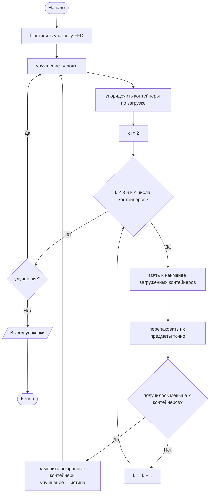
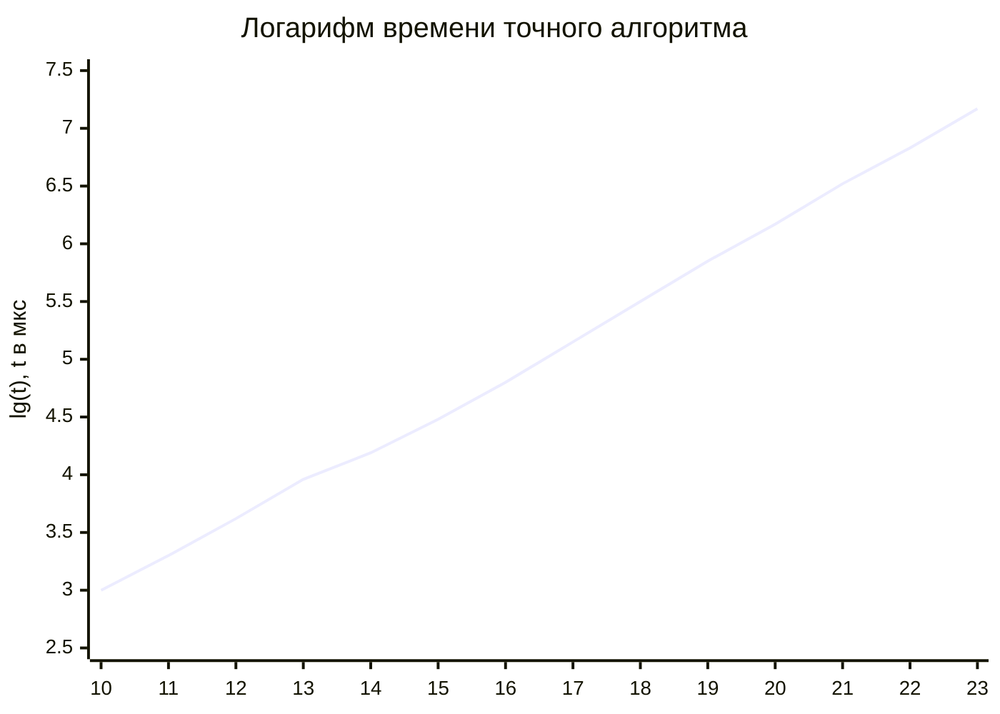
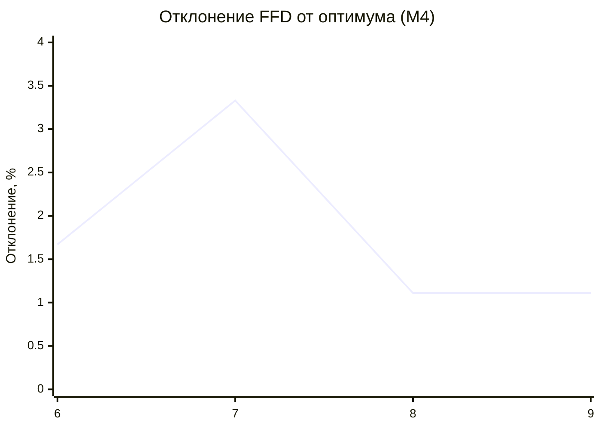

# Лабораторная работа № 12

## Точные и эвристические алгоритмы решения труднорешаемых задач комбинаторной оптимизации

**Вариант 11**
**Дисциплина:** Теория алгоритмов
**Язык реализации:** Python 3.14

---

## 1. Цель и задание варианта

**Цель:** изучить точные и приближённые методы решения NP-трудных задач, реализовать точный перебор с запоминанием, конструктивную эвристику и локальный поиск, а также сравнить их по времени и качеству.

**Исходные данные (табл. 1, вариант 11):**

| Параметр | Значение |
|---|---|
| Задача | Упаковка предметов в контейнеры |
| Точный метод | Полный перебор |
| Конструктивная эвристика | Первый подходящий с сортировкой (FFD) |
| Локальный поиск | Перенос предмета |
| Размерности | 10…15 (точно), 600 (эвристики) |
| Дополнительное задание | М4 |

**Задание М4:** исследовать зависимость качества эвристики от размерности и построить график среднего отклонения при $n=6,7,8,9$ относительно точного оптимума.

**Примечание о точном методе.** В варианте указан полный перебор. Прямой перебор всех разбиений при $n=15$ требует около $1{,}38\cdot10^9$ вариантов и не укладывается в разумное время, поэтому перебор дополнен запоминанием уже решённых подмножеств (ДП по подмножествам). Это по-прежнему точный алгоритм, а не эвристика: он находит гарантированный минимум контейнеров.

**Постановка задачи.** Даны $n$ предметов с размерами $w_i$ и контейнеры вместимости $C=100$. Требуется уложить все предметы в минимальное число контейнеров, не превышая вместимость. В работе размеры предметов — случайные целые числа от 10 до 50.

**Почему задача NP-трудна.** Задача распознавания «можно ли уложить предметы в $K$ контейнеров» NP-полна: к ней сводится задача о разбиении множества (PARTITION). Оптимизационная версия, в которой ищется минимальное $K$, является NP-трудной. Поэтому точный алгоритм имеет экспоненциальную сложность, а для больших $n$ применяют эвристики.

---

## 2. Теоретическая часть

### 2.1. Полиномиальная и экспоненциальная сложность

Алгоритм считается эффективным, если его трудоёмкость ограничена полиномом от размера входа. Экспоненциальные оценки $O(2^n)$ и $O(n!)$ означают практическую неприменимость при умеренных $n$: при $n=50$ величина $2^{50}\approx10^{15}$ уже требует около 13 суток при $10^9$ операций в секунду, а $50!$ превышает число атомов в наблюдаемой Вселенной.

Рост быстродействия техники проблему не решает: удвоение скорости увеличивает доступный размер задачи с факториальной сложностью примерно на единицу.

### 2.2. Классы P и NP

| Класс | Неформальное определение |
|---|---|
| P | Задачи, решаемые за полиномиальное время |
| NP | Задачи, решение которых можно проверить за полиномиальное время |
| NP-полные | Самые трудные задачи NP: полиномиальный алгоритм для одной дал бы его для всех |
| NP-трудные | Не легче NP-полных; могут не принадлежать NP (оптимизационные версии) |

Вопрос $\text{P}=\text{NP}$ открыт. Практическое следствие: для NP-трудной задачи не стоит искать точный полиномиальный алгоритм — разумная стратегия состоит в приближённом решении с контролируемым качеством.

### 2.3. Точные методы упаковки

**Полный перебор разбиений.** Каждое размещение предметов по контейнерам соответствует разбиению множества предметов на группы. Число таких разбиений — число Белла $B_n$; для $n=15$ оно равно $1\,382\,958\,545$, поэтому прямой перебор всех вариантов практически неприменим.

**Перебор с запоминанием (ДП по подмножествам).** Если для каждого подмножества предметов хранить минимальное число контейнеров и максимальное свободное место в последнем контейнере, то каждое подмножество решается один раз. Сложность — $\Theta(n\cdot2^n)$ по времени и $\Theta(2^n)$ по памяти. Это тот же точный перебор, но без повторного решения одинаковых подзадач: при $n=15$ вместо $1{,}38\cdot10^9$ разбиений обрабатывается $2^{15}=32\,768$ подмножеств.

Для восстановления самих контейнеров хранится массив предков: при переходе запоминается, был ли предмет положен в текущий контейнер или начал новый.

### 2.4. Конструктивная эвристика FFD

**First Fit Decreasing** сортирует предметы по убыванию размера и кладёт каждый в первый контейнер, где хватает места; если такого нет, открывает новый.

- Сортировка: $\Theta(n\log n)$.
- Укладка: $O(n\cdot K)$, где $K$ — число контейнеров; при простой реализации не хуже $O(n^2)$.
- Гарантия качества: $L_{\text{FFD}}\le\frac{11}{9}L_{\text{опт}}+\frac{6}{9}$.

Сортировка по убыванию — ключевая часть: крупные предметы труднее разместить, поэтому их фиксируют первыми, а мелкие заполняют оставшееся место.

### 2.5. Локальный поиск переносом предмета

Начальное решение — упаковка FFD. Локальный поиск пытается уменьшить число контейнеров: выбираются $k$ наименее загруженных контейнеров, их предметы перепаковываются заново, и если удаётся обойтись меньшим числом контейнеров, замена принимается. Процесс повторяется, пока есть улучшение.

При $k=2$ проверяется, можно ли объединить два контейнера в один; при $k=3$ — разложить три контейнера в два. Такая окрестность включает последовательность переносов отдельных предметов и позволяет выйти из локального оптимума, в котором один предмет никуда не помещается.

Результат — локальный оптимум: улучшить его в пределах выбранной окрестности нельзя, но глобальный оптимум может быть лучше. Гарантий качества у локального поиска нет.

### 2.6. Соотношение «время — качество»

| Метод | Время | Качество | Применимость |
|---|---|---|---|
| Полный перебор | $B_n$ | Оптимум | $n\le12$ |
| ДП по подмножествам | $\Theta(n2^n)$ | Оптимум | $n\le22$ |
| FFD | $O(n^2)$ | не хуже $11/9$ оптимума | любое $n$ |
| FFD + перенос | полиномиально при фиксированном $k$ | обычно лучше FFD | до тысяч предметов |

---

## 3. Блок-схема локального поиска



---

## 4. Листинг программы и пояснение работы кода

Полный код находится в файле [`lab12.py`](lab12.py). Ключевые функции:

```python
CAP = 100


def generate_items(n, seed=42):
    rng = random.Random(seed)
    return [rng.randint(10, 50) for _ in range(n)]


def first_fit_decreasing(items, cap=CAP):
    bins = []
    for x in sorted(items, reverse=True):
        for b in bins:
            if sum(b) + x <= cap:
                b.append(x)
                break
        else:
            bins.append([x])
    return bins


def exact_packing(items, cap=CAP):
    """ДП по подмножествам: (число контейнеров, -свободное место)."""
    n = len(items)
    size = 1 << n
    dp = [None] * size
    parent = [None] * size
    dp[0] = (0, -cap)
    for mask in range(size):
        state = dp[mask]
        if state is None:
            continue
        bins, neg_free = state
        free = -neg_free
        for i in range(n):
            if mask & (1 << i):
                continue
            x = items[i]
            if x <= free:
                cand, new_bin = (bins, -(free - x)), False
            else:
                cand, new_bin = (bins + 1, -(cap - x)), True
            nm = mask | (1 << i)
            if dp[nm] is None or cand < dp[nm]:
                dp[nm] = cand
                parent[nm] = (mask, i, new_bin)

    bins, cur, mask = [], [], size - 1
    while mask:
        prev, i, new_bin = parent[mask]
        cur.append(items[i])
        if new_bin:
            bins.append(cur)
            cur = []
        mask = prev
    if cur:
        bins.append(cur)
    return bins, size


def local_search(bins, cap=CAP, max_k=3):
    bins = [b[:] for b in bins]
    removed = 0
    while True:
        order = sorted(range(len(bins)), key=lambda k: sum(bins[k]))
        moved = False
        for k in range(2, min(max_k, len(bins)) + 1):
            idx = set(order[:k])
            group = [x for i in idx for x in bins[i]]
            packed, _ = exact_packing(group, cap)
            if len(packed) < k:
                bins = [b for i, b in enumerate(bins) if i not in idx] + packed
                removed += k - len(packed)
                moved = True
                break
        if not moved:
            return bins, removed
```

### 4.1. Как работает программа в целом

1. **`generate_items`** создаёт набор предметов размерами 10…50 при фиксированном seed, поэтому все замеры воспроизводимы.
2. **`first_fit_decreasing`** сортирует предметы по убыванию и кладёт каждый в первый подходящий контейнер.
3. **`exact_packing`** перебирает подмножества предметов. Для каждого хранится пара «число открытых контейнеров, отрицательное свободное место в последнем». Отрицание нужно, чтобы стандартное сравнение кортежей выбирало состояние с большим свободным местом. Массив `parent` позволяет восстановить упаковку.
4. **`local_search`** берёт 2–3 наименее загруженных контейнера, перепаковывает их тем же точным алгоритмом и заменяет исходные контейнеры, если новых меньше.
5. **`deviation`** считает отклонение эвристики от оптимума в процентах.

---

## 5. Характеристики вычислительной системы

| Параметр | Значение |
|---|---|
| ОС | macOS 26.4 (Darwin 25.4.0, arm64) |
| Процессор | Apple M5 |
| Оперативная память | 16 ГБ |
| Интерпретатор | Python 3.14.7 |

Методика замера: `time.perf_counter()`, один запуск на наборе данных. Для оценки качества используется 30 независимых наборов при каждом $n$. Совпадение точного ответа с полным перебором проверено на случайных наборах при $n\le10$.

---

## 6. Результаты

### 6.1. Рост времени точного алгоритма

Вместимость 100, размеры предметов 10…50, seed 42.

| $n$ | $2^n$ | Оптимум, контейнеров | Время, с |
|---|---|---|---|
| 6 | 64 | 2 | 0,0000 |
| 7 | 128 | 2 | 0,0001 |
| 8 | 256 | 2 | 0,0002 |
| 9 | 512 | 3 | 0,0005 |
| 10 | 1 024 | 3 | 0,0010 |
| 11 | 2 048 | 3 | 0,0020 |
| 12 | 4 096 | 4 | 0,0042 |
| 13 | 8 192 | 4 | 0,0092 |
| 14 | 16 384 | 4 | 0,0154 |
| 15 | 32 768 | 4 | 0,0299 |
| 16 | 65 536 | 4 | 0,0627 |
| 17 | 131 072 | 5 | 0,1400 |
| 18 | 262 144 | 5 | 0,3183 |
| 19 | 524 288 | 6 | 0,7151 |
| 20 | 1 048 576 | 6 | 1,4925 |
| 21 | 2 097 152 | 6 | 3,2774 |
| 22 | 4 194 304 | 6 | 6,8045 |
| 23 | 8 388 608 | 7 | 14,7731 |

При увеличении $n$ на единицу время растёт примерно вдвое, что соответствует множителю $2^n$ в оценке $\Theta(n2^n)$. Предельная размерность при лимите 10 с — $n=22$ (6,8 с); при $n=23$ расчёт занимает 14,8 с. Диапазон варианта 10…15 укладывается в 0,03 с, то есть с большим запасом.



График близок к прямой: логарифм времени линейно зависит от $n$, то есть само время растёт экспоненциально. Небольшой наклон вверх объясняется множителем $n$ перед $2^n$.

### 6.2. Качество эвристик на малых размерностях (М4)

Среднее отклонение от точного оптимума по 30 наборам:

| $n$ | FFD, % | FFD + перенос, % | Доля достижения оптимума |
|---|---|---|---|
| 6 | 1,67 | 0,00 | 100 % |
| 7 | 3,33 | 0,00 | 100 % |
| 8 | 1,11 | 0,00 | 100 % |
| 9 | 1,11 | 0,00 | 100 % |
| 10 | 5,28 | 4,17 | 87 % |
| 12 | 1,67 | 0,00 | 100 % |
| 15 | 1,50 | 0,83 | 97 % |



После локального поиска отклонение на $n=6\ldots9$ равно нулю во всех 30 наборах: эвристика каждый раз находила точный оптимум. На больших $n$ локальный поиск уже не всегда достигает оптимума: при $n=10$ среднее отклонение снижается с 5,28 % до 4,17 %, а доля точных решений составляет 87 %.

Отклонение FFD не убывает монотонно: при малых $n$ оно зависит от того, попал ли в набор предмет, из-за которого жадная укладка оставляет лишний контейнер. Среднее по 30 наборам сглаживает этот эффект, но полностью не убирает.

### 6.3. Большая размерность

$n=600$ предметов, вместимость 100, seed 7. Нижняя оценка — $\lceil\sum w_i/C\rceil=178$ контейнеров.

| Метод | Контейнеров | Время, с | Отклонение от нижней оценки |
|---|---|---|---|
| Нижняя оценка | 178 | — | — |
| FFD | 180 | 0,0015 | 1,12 % |
| FFD + перенос | 180 | 0,3309 | 1,12 % |

FFD уложил 600 предметов в 180 контейнеров, отстав от нижней оценки всего на 2 контейнера. Локальный поиск не смог убрать ни одного контейнера: упаковка плотная, и перепаковка любых двух-трёх контейнеров не даёт выигрыша. При этом локальный поиск потратил 0,33 с против 0,0015 с у FFD, то есть оказался более чем в 200 раз медленнее без улучшения результата.

Это ожидаемо для больших $n$: при равномерных размерах FFD асимптотически близок к оптимуму, а свободного места для переносов почти не остаётся. Локальный поиск полезен на малых и средних задачах, где упаковка менее плотная и перестановки могут освободить контейнер.

---

## 7. Выводы

1. Задача упаковки в контейнеры NP-трудна, поэтому точный алгоритм неизбежно экспоненциален. Полный перебор разбиений при $n=15$ требует около $1{,}38\cdot10^9$ вариантов, а ДП по подмножествам — всего $2^{15}=32\,768$ состояний. Мемоизация не меняет класс сложности, но делает точное решение реальным для $n\le22$.

2. Время точного алгоритма растёт как $2^n$: при увеличении $n$ на единицу оно примерно удваивается (например, с 3,28 с при $n=21$ до 6,80 с при $n=22$). Предел в 10 с достигается при $n=22$; при $n=23$ расчёт занимает 14,8 с. Диапазон варианта 10…15 решается за 0,03 с.

3. FFD — быстрая эвристика с оценкой не хуже $11/9$ оптимума. На 30 наборах её среднее отклонение составило 1,1–5,3 %, а на задаче с 600 предметами она отстала от нижней оценки всего на 2 контейнера (1,12 %). Время работы практически не зависит от качества упаковки и остаётся миллисекундным.

4. Локальный поиск переносом предмета существенно улучшает FFD на малых размерностях: при $n=6\ldots9$ он достиг оптимума во всех 30 наборах, при $n=10$ снизил отклонение с 5,28 % до 4,17 %. Это подтверждает, что окрестность из 2–3 контейнеров позволяет выйти из жадного локального оптимума.

5. На большой размерности локальный поиск не дал выигрыша: 180 контейнеров до и после, время выросло с 0,0015 до 0,33 с. Причина — плотная упаковка: свободного места в контейнерах почти нет, и перепаковка двух-трёх контейнеров не может уменьшить их число. Это иллюстрирует общий принцип: чем ближе решение к оптимуму, тем дороже каждая следующая единица улучшения.

6. Задание М4 выполнено: построен график среднего отклонения FFD при $n=6,7,8,9$; после локального поиска отклонение на этих размерностях равно нулю. Зависимость от $n$ немонотонна, потому что при малых $n$ результат сильно зависит от конкретного набора предметов.

7. Практическая рекомендация: для больших задач (сотни и тысячи предметов) использовать FFD — он даёт решение за миллисекунды с отклонением около 1–2 % от нижней оценки. Локальный поиск применять на малых и средних задачах или при наличии временного бюджета; для дальнейшего улучшения нужны более сильные окрестности (4-opt, обмен предметами) или метаэвристики. Точное решение оправдано только при $n\le22$ и высокой цене ошибки.
