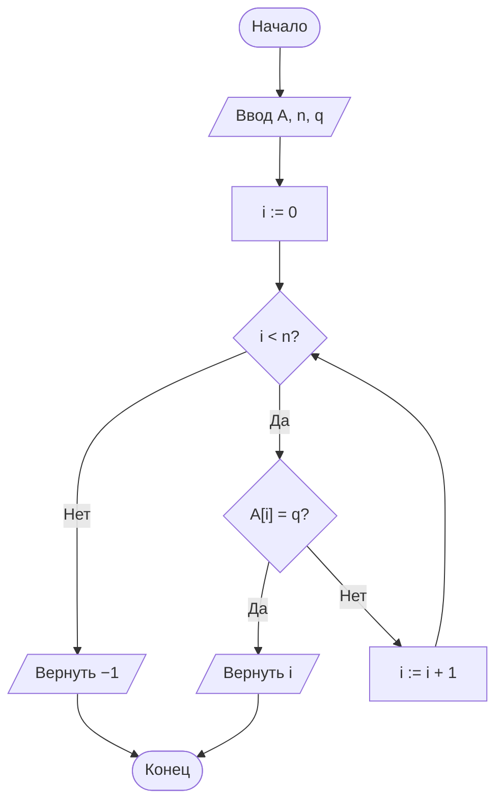
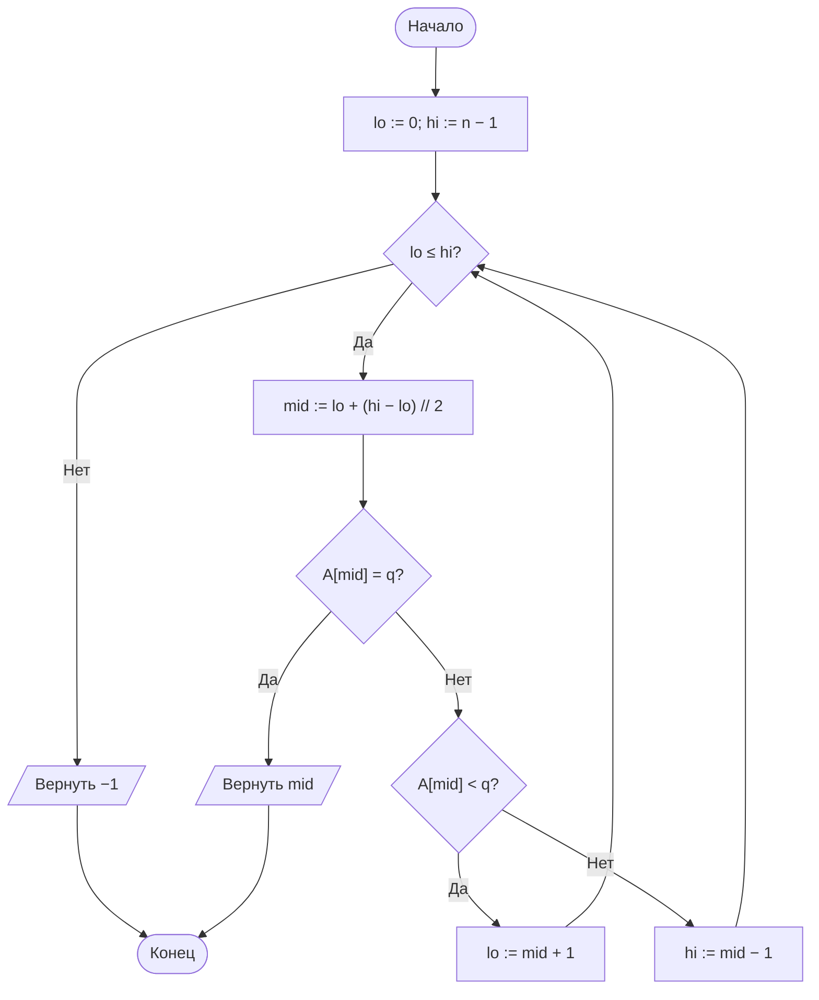
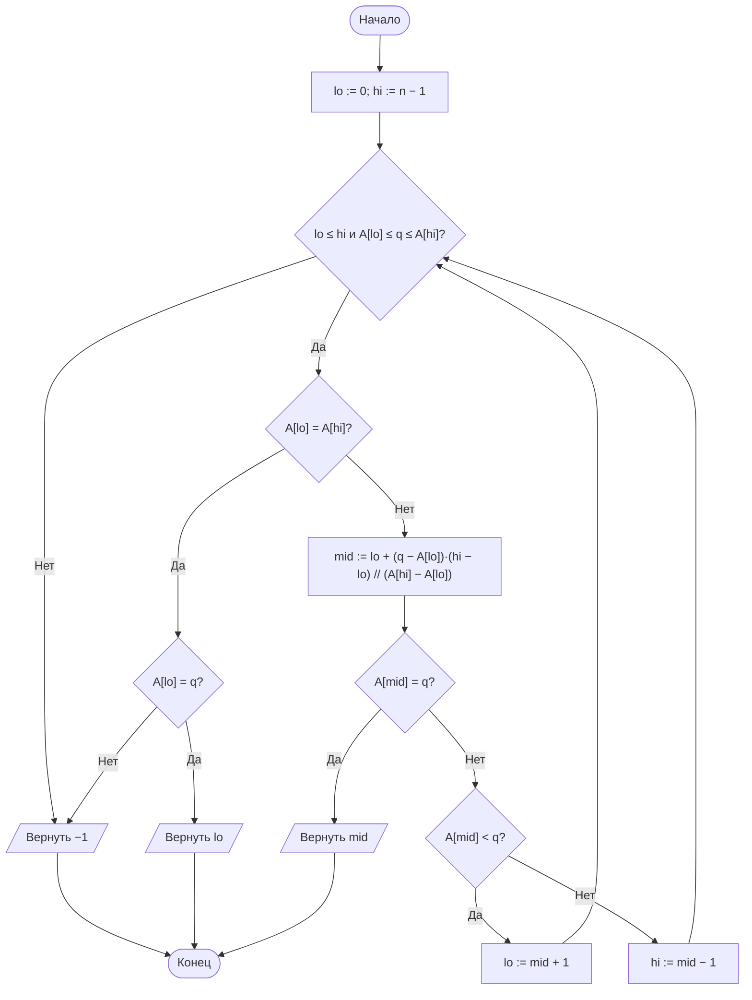
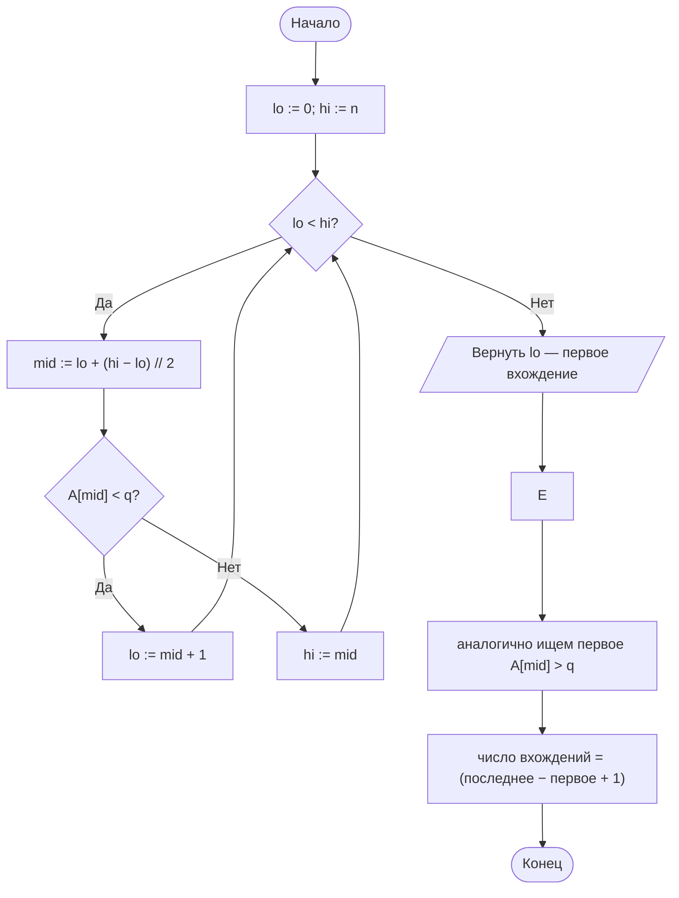

# Лабораторная работа № 4

## Анализ алгоритмов последовательного, двоичного и интерполяционного поиска

**Вариант 11**
**Дисциплина:** Теория алгоритмов
**Язык реализации:** Python 3.14

---

## 1. Цель и задание варианта

**Цель:** изучить алгоритмы поиска элемента в массиве, экспериментально сопоставить их трудоёмкость с теоретическими оценками и показать, как распределение ключей влияет на эффективность интерполяционного поиска.

**Исходные данные (табл. 2, вариант 11):**

| Параметр | Значение |
|---|---|
| Размеры массива $n$ | $10^3$, $10^4$, $10^5$ |
| Распределение ключей | К — кластеризованное: 90 % ключей из $[0;\ n]$, 10 % из $[10^6;\ 10^7]$ |
| Число запросов $k$ | 500 |
| Тип запросов | успешные |
| Дополнительное задание | Б4 |

**Дополнительное задание Б4:** реализовать поиск границ диапазона — первое и последнее вхождение ключа — за $O(\log n)$ и подсчёт числа вхождений; проверить на массиве с повторами.

---

## 2. Описание алгоритмов и теоретические оценки

### 2.1. Последовательный (линейный) поиск

Элементы просматриваются подряд до совпадения либо до конца массива. Не требует упорядоченности. Среднее число сравнений при успешном поиске:

$$C_{\text{ср}} = \frac{n+1}{2} = \Theta(n),\qquad C_{\max} = n.$$

### 2.2. Двоичный поиск

Применим только к упорядоченному массиву. На каждом шаге сравнивается средний элемент отрезка, после чего отрезок уменьшается вдвое:

$$C_{\max} = \lfloor \log_2 n \rfloor + 1 = \Theta(\log n).$$

### 2.3. Интерполяционный поиск

Вместо середины вычисляется **ожидаемая** позиция ключа в предположении равномерного распределения значений:

$$mid = lo + \left\lfloor \frac{(q - A[lo])(hi - lo)}{A[hi] - A[lo]} \right\rfloor.$$

При равномерном распределении — $O(\log \log n)$, при произвольном (например, кластеризованном) распределении деградирует вплоть до $\Theta(n)$. Именно этот случай исследуется в варианте 11.

### 2.4. Сводная таблица

| Алгоритм | Упорядоченность | Средний случай | Худший случай | Доп. память |
|---|---|---|---|---|
| Последовательный | Не требуется | $\Theta(n)$ | $\Theta(n)$ | $O(1)$ |
| Двоичный | Требуется | $\Theta(\log n)$ | $\Theta(\log n)$ | $O(1)$ |
| Интерполяционный | Требуется | $\Theta(\log\log n)$\* | $\Theta(n)$ | $O(1)$ |

\* при равномерном распределении ключей.

---

## 3. Блок-схемы алгоритмов

### 3.1. Последовательный поиск



### 3.2. Двоичный поиск



### 3.3. Интерполяционный поиск



### 3.4. Поиск границ диапазона (задание Б4)



---

## 4. Листинг программы и пояснение работы кода

Полный код приведён в файле [`lab4.py`](lab4.py) с подробными комментариями «КАК РАБОТАЕТ» к каждой функции. Ниже — ключевые фрагменты.

```python
def linear_search(a, q):
    """Последовательный поиск. Возвращает (индекс, число сравнений)."""
    for i, value in enumerate(a):
        if value == q:
            return i, i + 1
    return -1, len(a)


def binary_search(a, q):
    """Двоичный поиск в упорядоченном массиве."""
    lo, hi, cmps = 0, len(a) - 1, 0
    while lo <= hi:
        mid = lo + (hi - lo) // 2
        cmps += 1
        if a[mid] == q:
            return mid, cmps
        if a[mid] < q:
            lo = mid + 1
        else:
            hi = mid - 1
    return -1, cmps


def interpolation_search(a, q):
    """Интерполяционный поиск в упорядоченном массиве."""
    lo, hi, cmps = 0, len(a) - 1, 0
    while lo <= hi and a[lo] <= q <= a[hi]:
        if a[lo] == a[hi]:
            cmps += 1
            return (lo, cmps) if a[lo] == q else (-1, cmps)
        mid = lo + (q - a[lo]) * (hi - lo) // (a[hi] - a[lo])
        cmps += 1
        if a[mid] == q:
            return mid, cmps
        if a[mid] < q:
            lo = mid + 1
        else:
            hi = mid - 1
    return -1, cmps


def make_clustered_data(n, seed=42):
    """Массив распределения К: 90% ключей из [0; n], 10% из [10^6; 10^7]."""
    rng = random.Random(seed + n)
    small = int(round(0.9 * n))
    keys = [rng.randint(0, n) for _ in range(small)]
    keys += [rng.randint(10**6, 10**7) for _ in range(n - small)]
    keys.sort()
    return keys
```

Фрагмент дополнительного задания Б4:

```python
def lower_bound(a, q):
    """Индекс первого элемента >= q (как bisect_left). O(log n)."""
    lo, hi, cmps = 0, len(a), 0
    while lo < hi:
        mid = lo + (hi - lo) // 2
        cmps += 1
        if a[mid] < q:
            lo = mid + 1
        else:
            hi = mid
    return lo, cmps


def upper_bound(a, q):
    """Индекс первого элемента > q (как bisect_right). O(log n)."""
    lo, hi, cmps = 0, len(a), 0
    while lo < hi:
        mid = lo + (hi - lo) // 2
        cmps += 1
        if a[mid] <= q:
            lo = mid + 1
        else:
            hi = mid
    return lo, cmps


def count_occurrences(a, q):
    """Число вхождений ключа q (0, если отсутствует)."""
    lo, c1 = lower_bound(a, q)
    if lo == len(a) or a[lo] != q:
        return 0, c1
    up, c2 = upper_bound(a, q)
    return up - lo, c1 + c2
```

### 4.1. Как работает программа в целом

1. **Генерация данных** (`make_clustered_data`): для каждого размера $n$ строится отсортированный массив распределения К — 90 % ключей из узкого диапазона $[0;n]$ (из-за чего возникают повторы, «кластер»), 10 % — из широкого $[10^6;10^7]$.

2. **Генерация запросов** (`make_successful_queries`): берутся 500 случайных **индексов** массива, и запросом становится значение `data[index]`. Такой ключ гарантированно присутствует, поэтому все запросы успешные — как требует вариант.

3. **Замер** (`benchmark`): каждый из трёх алгоритмов прогоняется по всем 500 запросам; суммарное время серии делится на 500, чтобы получить среднее время одного запроса (отдельный запрос слишком быстр для прямого замера). Серия повторяется 5 раз, и берётся медиана — так случайные всплески ОС не искажают результат. Параллельно каждая функция возвращает число сделанных сравнений, которые усредняются.

4. **Сравнение с теорией** (`main`): для каждого алгоритма рядом с измеренным числом сравнений выводится теоретическая оценка — $\frac{n+1}{2}$ (последовательный), $\log_2 n$ (двоичный), $\log_2\log_2 n$ (интерполяционный).

5. **Доп. задание Б4**: функции `lower_bound` / `upper_bound` (два бинарных прохода) дают первое и последнее вхождение, а их разность — число вхождений. Результат сверяется с модулем `bisect` и наивным `list.count`.

---

## 5. Характеристики вычислительной системы

| Параметр | Значение |
|---|---|
| ОС | macOS 26.4 (Darwin 25.4.0, arm64) |
| Процессор | Apple M5 |
| Оперативная память | 16 ГБ |
| Интерпретатор | Python 3.14.7 |

Методика замера: среднее время одного запроса = суммарное время серии из 500 запросов, делённое на 500; берётся медиана по 5 повторениям серии для устойчивости к шуму. Число сравнений подсчитывается внутри алгоритмов и усредняется по всем запросам.

---

## 6. Результаты измерений

### 6.1. Среднее время одного запроса, мкс

| $n$ | Последовательный | Двоичный | Интерполяционный |
|---|---|---|---|
| $10^3$ | 5,97 | 0,41 | 26,00 |
| $10^4$ | 57,05 | 0,53 | 145,42 |
| $10^5$ | 615,67 | 0,70 | 70,61 |

### 6.2. Среднее число сравнений на один запрос

| $n$ | Последовательный | Теория $\frac{n+1}{2}$ | Двоичный | Теория $\log_2 n$ | Интерполяционный | Теория $\log_2\log_2 n$ |
|---|---|---|---|---|---|---|
| $10^3$ | 513,34 | 500,5 | 8,32 | 9,97 | 390,90 | 3,32 |
| $10^4$ | 4880,02 | 5000,5 | 11,58 | 13,29 | 2076,63 | 3,73 |
| $10^5$ | 49481,72 | 50000,5 | 14,94 | 16,61 | 951,34 | 4,05 |

Зависимость времени и числа сравнений от $n$ наглядно видна из таблиц: время последовательного поиска растёт примерно в 10 раз при увеличении $n$ в 10 раз, у двоичного — почти не меняется, у интерполяционного — остаётся большим и нестабильным из-за кластеризации.

### 6.3. Наблюдения

- **Последовательный поиск.** Число сравнений близко к теоретическому $\frac{n+1}{2}$, а время растёт примерно в 10 раз при каждом увеличении $n$ в 10 раз ($5{,}97 \to 57{,}05 \to 615{,}67$ мкс) — линейная зависимость $\Theta(n)$.
- **Двоичный поиск.** Число сравнений близко к $\log_2 n$ ($8{,}3 \to 11{,}6 \to 14{,}9$), время почти не меняется ($0{,}41 \to 0{,}53 \to 0{,}70$ мкс) — логарифмическая зависимость $\Theta(\log n)$.
- **Интерполяционный поиск.** На кластеризованном распределении К число сравнений составляет сотни–тысячи вместо теоретических $3$–$4$ ($\log_2\log_2 n$). Это наглядно показывает деградацию интерполяционного поиска до уровня, близкого к $\Theta(n)$, на неравномерных данных. По времени он во всех точках проигрывает двоичному поиску.

---

## 7. Дополнительное задание Б4

Реализованы функции `lower_bound`, `upper_bound`, `first_occurrence`, `last_occurrence` и `count_occurrences`, работающие за $O(\log n)$ каждая (два бинарных прохода). Проверка выполнена на кластеризованном массиве с $n = 10^4$ (содержит 3029 повторов) и сверена со стандартным модулем `bisect` и наивным подсчётом `list.count`.

| Ключ | Первое вхождение | Последнее вхождение | Число вхождений | `bisect` | Наивный `count` |
|---|---|---|---|---|---|
| 4545 | 3984 | 3989 | 6 | 6 | 6 |
| 0 | 0 | 0 | 1 | 1 | 1 |
| 9995486 | 9999 | 9999 | 1 | 1 | 1 |
| 9995491 (нет в массиве) | −1 | −1 | 0 | 0 | 0 |

Результаты всех трёх способов совпали. Число сравнений для подсчёта вхождений составило $\approx 2\log_2 n \approx 26$ (два бинарных прохода), что подтверждает сложность $O(\log n)$ и независимость от числа самих вхождений: поиск 6 вхождений ключа 4545 требует тех же $\sim 26$ сравнений, что и поиск одиночного ключа.

---

## 8. Выводы

1. Экспериментальные данные подтверждают теоретические оценки: последовательный поиск даёт $\approx\frac{n+1}{2}$ сравнений, двоичный — $\approx\log_2 n$. При увеличении $n$ в 10 раз время линейного поиска растёт примерно в 10 раз, а двоичного — лишь на постоянную величину, что соответствует разнице $\Theta(n)$ и $\Theta(\log n)$.

2. На кластеризованном распределении К интерполяционный поиск **деградирует**: число сравнений (сотни–тысячи) на порядки превышает теоретическое $\log_2\log_2 n \approx 3$–$4$ и приближается к $\Theta(n)$. Причина в том, что формула интерполяции предполагает равномерное распределение ключей, которое для кластеризованных данных нарушается (тесный кластер $[0;n]$ и далёкий кластер $[10^6;10^7]$). По времени интерполяционный поиск проигрывает двоичному на всех исследованных размерах.

3. Двоичный поиск показал наилучшую устойчивость: и по времени, и по числу сравнений он остаётся логарифмическим независимо от распределения ключей.

4. Дополнительное задание Б4 выполнено: поиск первого и последнего вхождения за $O(\log n)$ позволяет за два бинарных прохода получить число вхождений повторяющегося ключа, что существенно быстрее линейного перебора при большом $n$.

5. Практический вывод: выбор алгоритма поиска определяется распределением данных. При неравномерных (кластеризованных) ключах следует предпочесть двоичный поиск; интерполяционный выгоден только на больших массивах с равномерно распределёнными ключами.
