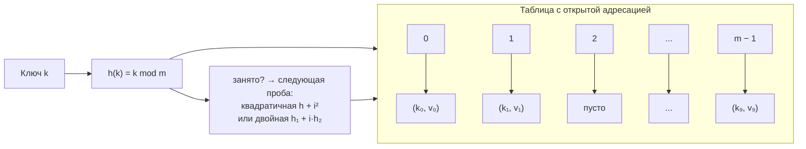
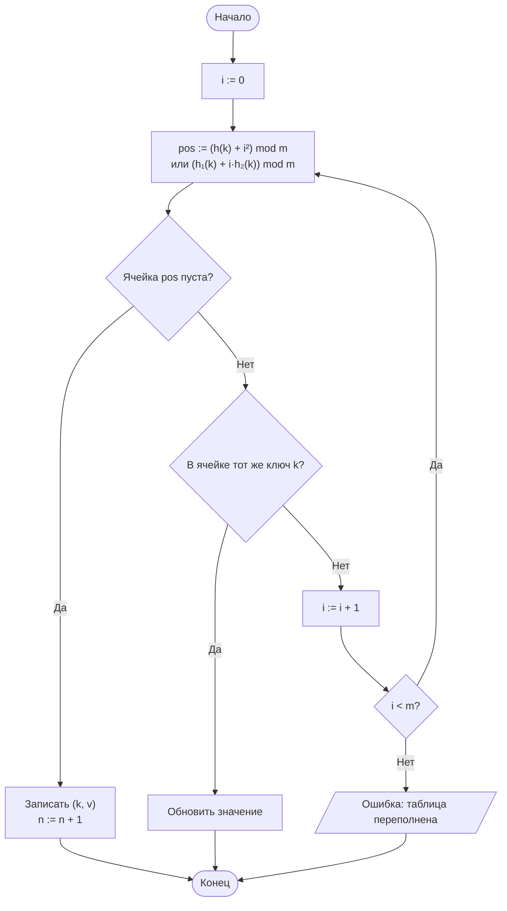

# Лабораторная работа № 5

## Хеширование и экспериментальное исследование методов разрешения коллизий

**Вариант 11**
**Дисциплина:** Теория алгоритмов
**Язык реализации:** Python 3.14

---

## 1. Цель и задание варианта

**Цель:** изучить принципы хеширования, реализовать хеш-таблицу с открытой адресацией и экспериментально исследовать, как коэффициент заполнения $\alpha$ и способ разрешения коллизий влияют на число проб и время работы.

**Исходные данные (табл. 1, вариант 11):**

| Параметр | Значение |
|---|---|
| Тип ключей | Целые случайные числа |
| Хеш-функция | Д — метод деления $h(k) = k \bmod m$, $m = 65\,521$ (простое) |
| Разрешение коллизий | К — квадратичное пробирование; Дв — двойное хеширование |
| Число элементов $n$ | 40 000 |
| Размер таблицы $m$ | 65 521 |
| Дополнительное задание | В4 |

**Дополнительное задание В4:** построить экспериментальную зависимость числа проб от $\alpha \in \{0{,}1; 0{,}3; 0{,}5; 0{,}7; 0{,}9; 0{,}95\}$ и сопоставить её с теоретической кривой $\frac{1}{1-\alpha}$.

---

## 2. Описание хеш-функции и методов разрешения коллизий

### 2.1. Хеш-функция (метод деления)

$$h(k) = k \bmod m, \qquad m = 65\,521\ \text{(простое число)}.$$

Размер таблицы выбран **простым**: тогда в остаток вовлекаются все разряды ключа и значения распределяются по ячейкам равномерно. Если бы $m$ было степенью двойки, `k % m` зависел бы только от младших битов ключа, что дало бы лишние коллизии.

### 2.2. Открытая адресация

Все элементы хранятся непосредственно в массиве; при занятости ячейки проверяется следующая по правилу пробирования:

- **Квадратичное пробирование:** $h_i(k) = (h(k) + i^2) \bmod m$. Шаг растёт как $1, 4, 9, \dots$, что уменьшает образование длинных сплошных участков (первичную кластеризацию) по сравнению с линейным пробированием.
- **Двойное хеширование:** $h_i(k) = (h_1(k) + i \cdot h_2(k)) \bmod m$, где $h_2(k) = 1 + (k \bmod (m-1))$. Так как $m$ простое, шаг $h_2(k) \in [1; m-1]$ взаимно прост с $m$, поэтому последовательность проб проходит **все** $m$ ячеек ровно по одному разу. У каждого ключа свой шаг, поэтому распределение проб наилучшее.

### 2.3. Коэффициент заполнения и теоретическая оценка

$$\alpha = \frac{n}{m}, \qquad C_{\text{ср}} \approx \frac{1}{1-\alpha}\ \text{(неуспешный поиск)}.$$

При $\alpha = 0{,}5$ нужно около 2 проб, при $\alpha = 0{,}9$ — около 10, при $\alpha \to 1$ трудоёмкость неограниченно растёт.

---

## 3. Схема структуры данных



### Блок-схема вставки (открытая адресация)



---

## 4. Листинг программы и пояснение работы кода

Полный код приведён в файле [`lab5.py`](lab5.py) с подробными комментариями «КАК РАБОТАЕТ» к каждой функции. Ниже — ключевые фрагменты.

```python
class OpenAddressingTable:
    EMPTY = object()          # маркер «ячейка пуста»

    def __init__(self, m, probing="double"):
        self.m = m
        self.probing = probing              # "quadratic" или "double"
        self.keys = [self.EMPTY] * m
        self.values = [None] * m
        self.n = 0
        self.probes = 0                     # счётчик проб (для замера)

    def _h1(self, key):
        return key % self.m                 # метод деления

    def _h2(self, key):
        return 1 + (key % (self.m - 1))     # шаг для двойного хеширования

    def _position(self, key, i):
        if self.probing == "quadratic":
            return (self._h1(key) + i * i) % self.m
        return (self._h1(key) + i * self._h2(key)) % self.m

    def insert(self, key, value):
        p = 0
        for i in range(self.m):
            p += 1
            pos = self._position(key, i)
            k = self.keys[pos]
            if k is self.EMPTY:
                self.keys[pos] = key
                self.values[pos] = value
                self.n += 1
                self.probes += p
                return
            if k == key:
                self.values[pos] = value     # ключ уже был
                self.probes += p
                return
        raise RuntimeError("таблица переполнена")

    def search(self, key):
        for i in range(self.m):
            self.probes += 1
            pos = self._position(key, i)
            k = self.keys[pos]
            if k is self.EMPTY:
                return None                  # пустая ячейка → ключа нет
            if k == key:
                return self.values[pos]
        return None
```

### 4.1. Как работает программа в целом

1. **Хеш-функция** `_h1` — остаток от деления на простое $m = 65\,521$. `_h2` — вторая функция для двойного хеширования, дающая шаг, взаимно простой с $m$.

2. **Пробирование** `_position(key, i)` — возвращает позицию $i$-й пробы: для квадратичного это `h + i²`, для двойного — `h₁ + i·h₂`.

3. **Вставка** `insert` — идёт по последовательности проб, пока не найдёт пустую ячейку (кладёт ключ) либо тот же ключ (обновляет значение). Каждая просмотренная ячейка — одна «проба».

4. **Поиск** `search` — идёт по той же последовательности; дойдя до пустой ячейки, заключает, что ключа нет (иначе вставка положила бы его не дальше этой точки).

5. **Замер** `run_experiment` — заполняет таблицу, затем ищет сначала **успешные** ключи (есть в таблице), потом **неуспешные** (из непересекающегося диапазона, их гарантированно нет), и считает среднее число проб на запрос.

6. **Сравнение хеш-функций** — одна и та же последовательность ключей раскладывается по ячейкам функцией `k % 65_521` (хорошая) и `k % 10` (плохая); по распределению размеров ячеек видно, насколько различается равномерность.

7. **Доп. задание В4** — при каждом $\alpha$ заполняется свежая таблица до $\alpha \cdot m$ ключей и измеряется среднее число проб при неуспешном поиске; результат сопоставляется с $\frac{1}{1-\alpha}$.

---

## 5. Характеристики вычислительной системы

| Параметр | Значение |
|---|---|
| ОС | macOS 26.4 (Darwin 25.4.0, arm64) |
| Процессор | Apple M5 |
| Оперативная память | 16 ГБ |
| Интерпретатор | Python 3.14.7 |

Методика замера: суммарное время серии из 10 000 запросов делится на их число; число проб накапливается внутри таблицы и усредняется по запросам.

---

## 6. Результаты измерений

### 6.1. Основной эксперимент ($n = 40\,000$, $m = 65\,521$, $\alpha = 0{,}6105$)

| Метод | Вставка, с | Поиск, с | Проб/успешный | Проб/неуспешный | Макс. проб (вставка) | Макс. кластер |
|---|---|---|---|---|---|---|
| Квадратичное пробирование | 0,011 | 0,002 | 1,62 | 2,84 | 19 | 37 |
| Двойное хеширование | 0,012 | 0,003 | 1,54 | 2,57 | 15 | 24 |
| Встроенный `dict` | 0,001 | 0,000 | — | — | — | — |

Теоретическая оценка неуспешного поиска $\frac{1}{1-\alpha} = 2{,}57$, что практически совпадает с измеренным значением 2,57 у двойного хеширования.

### 6.2. Хорошая и плохая хеш-функции (40 000 ключей)

| Хеш-функция | Ячеек | Макс. размер ячейки | Пустых ячеек | Ст. отклонение |
|---|---|---|---|---|
| $k \bmod 65\,521$ (хорошая) | 65 521 | 7 | 35 498 | 0,60 |
| $k \bmod 10$ (плохая) | 10 | 4 071 | 0 | 39,48 |

Плохая функция распределяет все 40 000 ключей всего по 10 ячейкам (в среднем 4 000 в каждой), из-за чего почти каждый поиск превращается в длинный перебор внутри ячейки. Хорошая функция даёт распределение, близкое к пуассоновскому: максимум 7 ключей в ячейке, более половины ячеек пусты.

### 6.3. Дополнительное задание В4 — число проб при неуспешном поиске

| $\alpha$ | Квадратичное | Двойное хеширование | Теория $\frac{1}{1-\alpha}$ |
|---|---|---|---|
| 0,10 | 1,11 | 1,11 | 1,11 |
| 0,30 | 1,47 | 1,43 | 1,43 |
| 0,50 | 2,14 | 2,01 | 2,00 |
| 0,70 | 3,72 | 3,32 | 3,33 |
| 0,90 | 11,71 | 9,94 | 10,00 |
| 0,95 | 23,09 | 19,97 | 20,00 |

Оба метода при малых $\alpha$ дают почти 1 пробу. С ростом $\alpha$ число проб растёт как $\frac{1}{1-\alpha}$; при $\alpha = 0{,}95$ требуется уже около 20 проб. Двойное хеширование практически точно ложится на теоретическую кривую (19,97 против 20,00), а квадратичное отклоняется чуть сильнее (23,09) из-за остаточной кластеризации.

---

## 7. Выводы

1. Эксперимент подтверждает теоретическую модель открытой адресации: среднее число проб при неуспешном поиске близко к $\frac{1}{1-\alpha}$. При $\alpha \approx 0{,}61$ обе реализации находят ключ в среднем менее чем за 3 пробы, т.е. за время, близкое к $O(1)$.

2. Двойное хеширование распределяет ключи равномернее квадратичного пробирования: у него меньше и среднее число проб (1,54 против 1,62 при успешном поиске; 2,57 против 2,84 при неуспешном), и максимальная длина кластера (24 против 37). На графике В4 его кривая точнее совпадает с теорией $\frac{1}{1-\alpha}$.

3. Качество хеш-функции критично: функция $k \bmod 65\,521$ даёт максимум 7 ключей в ячейке, а заведомо неудачная $k \bmod 10$ — до 4 071. Это наглядно объясняет, почему размер таблицы рекомендуется брать простым числом.

4. Встроенный `dict` быстрее собственной реализации (написан на C и использует оптимизированную схему пробирования). Собственная реализация имеет учебное назначение — она позволяет наблюдать число проб и кластеризацию, недоступные через стандартный интерфейс.

5. Практический вывод: при увеличении заполнения таблицы число проб растёт как $\frac{1}{1-\alpha}$ и резко возрастает при $\alpha \to 1$, поэтому в реальных хеш-таблицах выполняют рехеширование (расширение), не дожидаясь полного заполнения, — амортизированная стоимость вставки при этом остаётся $O(1)$.
