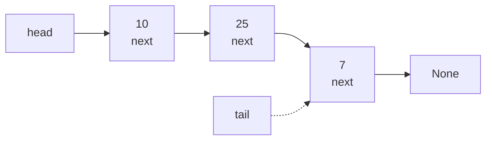
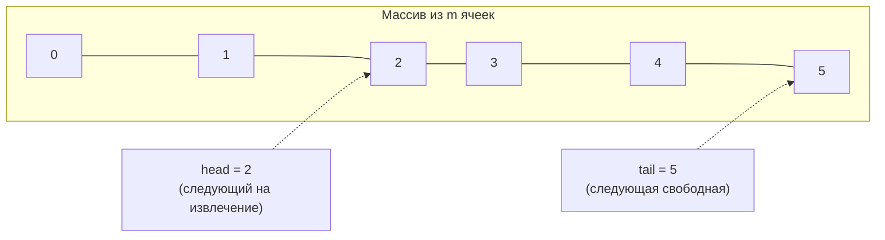

# Лабораторная работа № 6

## Реализация линейных структур данных и анализ трудоёмкости их операций

**Вариант 11**
**Дисциплина:** Теория алгоритмов
**Язык реализации:** Python 3.14

---

## 1. Цель и задание варианта

**Цель:** реализовать линейные структуры данных (односвязный список, очередь на кольцевом буфере) и экспериментально установить, как выбор структуры определяет трудоёмкость операций постановки, извлечения и обработки переполнения.

**Исходные данные (табл. 1, вариант 11):**

| Параметр | Значение |
|---|---|
| Структуры | Кольцевой буфер, список |
| Исследуемые операции | Постановка (enqueue), извлечение (dequeue), переполнение |
| Размеры $n$ | 5 000; 10 000; 20 000 |
| Прикладная задача | Буфер последних 100 событий |

**Дополнительные требования (табл. 2):** Т1 — корректность на малом примере; Т2 — время операций для своей реализации и встроенного `list`; Т3 — определить оценку ($\Theta(1)$ или $\Theta(n)$) по отношению $T(2n)/T(n)$; Т4 — расход памяти на 10 000 элементов через `sys.getsizeof`.

---

## 2. Описание реализованных структур

### 2.1. Односвязный список (`LinkedList`)

Узлы хранят значение и ссылку на следующий узел. Ссылка на **хвост** позволяет вставлять в конец за $\Theta(1)$.

| Операция | Трудоёмкость |
|---|---|
| `push_front`, `push_back`, `pop_front` | $\Theta(1)$ |
| `get(i)`, `find(v)`, `insert(i)` | $\Theta(n)$ — проход от начала |

### 2.2. Очередь на кольцевом буфере (`CircularQueue`)

Данные лежат в массиве фиксированной ёмкости; хранятся индекс головы `head` и счётчик `count`. Позиция хвоста вычисляется как `(head + count) % capacity`. При достижении конца массива индексы «перепрыгивают» в начало, поэтому обе операции выполняются за $\Theta(1)$ без сдвигов.

- **Переполнение (строгий режим):** при заполнении буфер поднимает `OverflowError`.
- **Переполнение (режим перезаписи):** новый элемент затирает самый старый — так буфер всегда хранит последние `capacity` элементов.

---

## 3. Схемы структур

### 3.1. Односвязный список



### 3.2. Кольцевой буфер



---

## 4. Листинг программы и пояснение работы кода

Полный код приведён в файле [`lab6.py`](lab6.py) с комментариями «КАК РАБОТАЕТ». Ключевые фрагменты:

```python
class Node:
    __slots__ = ("value", "next")     # экономит память (нет лишних атрибутов)
    def __init__(self, value, nxt=None):
        self.value = value
        self.next = nxt


class LinkedList:
    def __init__(self):
        self.head = None
        self.tail = None              # ссылка на хвост -> push_back за Θ(1)
        self.size = 0

    def push_front(self, value):
        self.head = Node(value, self.head)
        if self.tail is None:
            self.tail = self.head
        self.size += 1

    def push_back(self, value):
        node = Node(value)
        if self.tail is None:
            self.head = self.tail = node
        else:
            self.tail.next = node
            self.tail = node
        self.size += 1

    def get(self, index):
        node = self.head
        for _ in range(index):        # доступ по индексу — проход от начала Θ(n)
            node = node.next
        return node.value


class CircularQueue:
    def __init__(self, capacity, overwrite=False):
        self.capacity = capacity
        self.data = [None] * capacity
        self.head = 0                 # следующий на извлечение
        self.count = 0                # текущее число элементов
        self.overwrite = overwrite

    def enqueue(self, value):
        if self.count == self.capacity:
            if not self.overwrite:
                raise OverflowError("очередь переполнена")
            self.data[self.head] = value      # затираем самый старый
            self.head = (self.head + 1) % self.capacity
            return
        tail = (self.head + self.count) % self.capacity
        self.data[tail] = value
        self.count += 1

    def dequeue(self):
        value = self.data[self.head]
        self.data[self.head] = None
        self.head = (self.head + 1) % self.capacity
        self.count -= 1
        return value
```

### 4.1. Как работает программа в целом

1. **`LinkedList`** — односвязный список; операции в начале/конце переставляют ссылки за $\Theta(1)$, доступ по индексу и поиск требуют прохода от начала за $\Theta(n)$.

2. **`CircularQueue`** — очередь на кольцевом буфере; постановка и извлечение вычисляют позицию через остаток от деления и выполняются за $\Theta(1)$.

3. **Т1** — на малом примере вывод содержимого после каждой операции; проверяется и строгое переполнение (`OverflowError`), и режим перезаписи.

4. **Т2/Т3** — для каждой операции замеряется время при $n = 5000, 10\,000, 20\,000$, затем считается отношение $T(2n)/T(n)$: значение около 2 соответствует линейной зависимости, около 4 — квадратичной.

5. **Переполнение** — n событий пропускаются через буфер ёмкости 100 в режиме перезаписи (кольцо) и через `list` с вытеснением (`pop(0)`).

6. **Т4** — `sys.getsizeof` суммирует память массива/узлов и объектов `int`, чтобы сравнить накладные расходы структур.

7. **Прикладная задача** — буфер последних 100 событий реализован кольцевым буфером с перезаписью: при заполнении новый элемент вытесняет самый старый.

---

## 5. Характеристики вычислительной системы

| Параметр | Значение |
|---|---|
| ОС | macOS 26.4 (Darwin 25.4.0, arm64) |
| Процессор | Apple M5 |
| Оперативная память | 16 ГБ |
| Интерпретатор | Python 3.14.7 |

Методика замера: медиана по 3 повторениям каждого действия.

---

## 6. Результаты

### 6.1. Т1 — корректность на малом примере

Односвязный список: после `push_back(10)`, `push_back(25)`, `push_front(7)`, `insert(1, 99)`, `pop_front()` список принимает вид `[99, 10, 25]`; `get(2) = 25`, `find(10) = 1`, `find(999) = -1`.

Кольцевой буфер ёмкости 4 корректно обрабатывает постановку/извлечение, а при попытке вставить пятый элемент поднимает `OverflowError`. В режиме перезаписи буфер после 250 событий хранит ровно последние 100 (с `событие-150` по `событие-249`).

### 6.2. Т2 — время постановки и извлечения, с

| $n$ | Кольцо: enqueue | `list`: append | Кольцо: dequeue | `list`: pop(0) | Список: dequeue |
|---|---|---|---|---|---|
| 5 000 | 0,00047 | 0,00008 | 0,00084 | 0,00127 | 0,00077 |
| 10 000 | 0,00080 | 0,00014 | 0,00148 | 0,00432 | 0,00136 |
| 20 000 | 0,00142 | 0,00025 | 0,00263 | 0,01724 | 0,00243 |

### 6.3. Т3 — отношение $T(2n)/T(n)$ и соответствие оценке

| Операция | $T(10k)/T(5k)$ | $T(20k)/T(10k)$ | Оценка |
|---|---|---|---|
| Кольцо: enqueue | 1,69 | 1,78 | $\Theta(1)$ на операцию |
| `list`: append | 1,70 | 1,73 | $\Theta(1)$ амортизированно |
| Кольцо: dequeue | 1,75 | 1,78 | $\Theta(1)$ на операцию |
| `list`: pop(0) | 3,39 | 3,99 | $\Theta(n)$ на операцию ($\Theta(n^2)$ суммарно) |
| Связный список: dequeue | 1,76 | 1,78 | $\Theta(1)$ на операцию |

Отношение ≈ 2 у кольцевого буфера, `append` и связного списка подтверждает линейную (по $\Theta(1)$ на операцию) зависимость; у `list.pop(0)` отношение ≈ 4 указывает на квадратичную зависимость — каждый `pop(0)` сдвигает весь массив.

### 6.4. Переполнение — обработка n событий буфером ёмкости 100, с

| $n$ | Кольцо: перезапись | `list`: последние 100 |
|---|---|---|
| 5 000 | 0,00027 | 0,00014 |
| 10 000 | 0,00052 | 0,00027 |
| 20 000 | 0,00105 | 0,00055 |

Обе реализации линейны ($\Theta(1)$ на событие). При столь малой ёмкости (100) встроенный `list` быстрее за счёт C-реализации, однако кольцевой буфер гарантирует фиксированную память и отсутствие сдвигов при любой ёмкости.

### 6.5. Т4 — расход памяти на 10 000 элементов

| Структура | Накладные расходы | Итого с объектами `int` |
|---|---|---|
| Встроенный `list` | 80 056 байт (указатели) | 360 056 байт |
| Односвязный список | 480 000 байт (узлы) | 760 000 байт |
| Кольцевой буфер | 80 056 байт (массив) | 360 056 байт |

На элемент связного списка приходится 48 байт (узел: значение + ссылка + служебные поля объекта), тогда как массив хранит лишь 8-байтный указатель. Поэтому связный список занимает примерно вдвое больше памяти, хотя его вставка/удаление в начале работают за $\Theta(1)$.

---

## 7. Сводная таблица «операция — структура — теория — эксперимент»

| Операция | Структура | Теория (на операцию) | Эксперимент $T(2n)/T(n)$ | Вывод |
|---|---|---|---|---|
| Постановка | Кольцевой буфер | $\Theta(1)$ | 1,7–1,8 | Подтверждено |
| Постановка | `list` (append) | $\Theta(1)$ амортиз. | 1,7 | Подтверждено |
| Извлечение | Кольцевой буфер | $\Theta(1)$ | 1,75–1,78 | Подтверждено |
| Извлечение | `list` (pop(0)) | $\Theta(n)$ | 3,4–4,0 | Подтверждено ($\Theta(n^2)$ суммарно) |
| Извлечение | Связный список | $\Theta(1)$ | 1,76–1,78 | Подтверждено |
| Переполнение | Кольцевой буфер (перезапись) | $\Theta(1)$ | линейно | Подтверждено |

---

## 8. Обоснование выбора структуры для прикладной задачи

Задача «буфер последних 100 событий» требует хранить ограниченное число последних записей и быстро добавлять новые, вытесняя старые. Кольцевой буфер — идеальное решение:

1. **Фиксированная память** — буфер всегда занимает ровно `capacity` ячеек, без перевыделений.
2. **$\Theta(1)$ на операцию** — и добавление, и вытеснение старого элемента сводятся к записи по индексу и сдвигу указателя `head` по модулю, без перемещения остальных элементов.
3. **Естественная семантика FIFO** — старейшее событие автоматически замещается новым.

Альтернатива на `list` (`append` + `pop(0)`) тоже работает, но требует сдвига всех элементов при удалении старого; при малой ёмкости это незначительно, однако при росте ёмкости кольцевой буфер сохраняет строго $\Theta(1)$, а `pop(0)` становится $\Theta(n)$.

---

## 9. Выводы

1. Эксперимент подтверждает теоретические оценки: постановка и извлечение у кольцевого буфера и связного списка имеют $\Theta(1)$ на операцию (отношение $T(2n)/T(n)\approx 2$), а извлечение из обычного `list` через `pop(0)` — $\Theta(n)$ на операцию (отношение $\approx 4$, т.е. квадратичная суммарная зависимость).

2. Вставка в конец `list` (`append`) эффективна благодаря амортизированному удвоению ёмкости и C-реализации; по абсолютному времени она даже быстрее собственной кольцевой очереди. Это иллюстрирует важный тезис: асимптотика и абсолютная скорость — разные вещи, и встроенные структуры на C часто выигрывают у «чистых» Python-реализаций при одинаковой сложности.

3. Связный список проигрывает массиву по памяти (48 байт на элемент против 8 байт указателя), зато даёт вставку/удаление в начале за $\Theta(1)$ без сдвигов.

4. Кольцевой буфер — оптимальная структура для буфера ограниченной длины (последние N событий): постоянная память и $\Theta(1)$ на операцию независимо от ёмкости.

5. Практический вывод: структуру данных выбирают по преобладающим операциям. Для FIFO-очереди с ограниченной длиной следует использовать кольцевой буфер; универсально лучшей структуры не существует.
