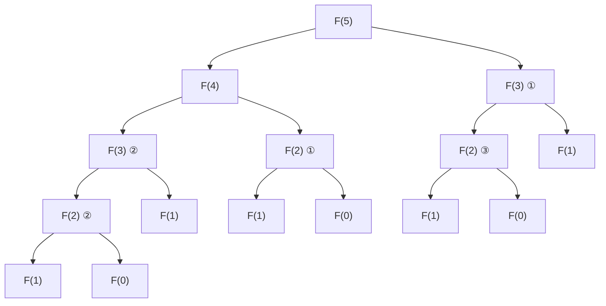
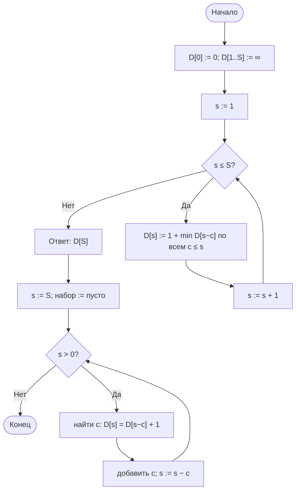

# Лабораторная работа № 7

## Рекурсивные алгоритмы и динамическое программирование в задачах комбинаторной оптимизации

**Вариант 11**
**Дисциплина:** Теория алгоритмов
**Язык реализации:** Python 3.14

---

## 1. Цель и задание варианта

**Цель:** изучить динамическое программирование как способ устранения повторных вычислений в рекурсивных алгоритмах и сравнить трудоёмкость наивной рекурсии, мемоизации и итеративного решения.

**Исходные данные (табл. 1, вариант 11):**

| Параметр | Значение |
|---|---|
| Задача А | Числа Фибоначчи |
| Параметр $n$ | 10…31 |
| Задача Б | Размен суммы |
| Данные задачи Б | $S = 250$, номиналы 1, 4, 6, 9 |
| Дополнительное задание | Г4 |

**Дополнительное задание Г4:** исследовать зависимость времени ДП от $S$ при фиксированных номиналах, подтвердить линейность и пояснить понятие псевдополиномиальности.

---

## 2. Теоретическая часть

### 2.1. Задача А — числа Фибоначчи

Числа Фибоначчи задаются рекуррентным соотношением

$$F(0)=0,\qquad F(1)=1,\qquad F(n)=F(n-1)+F(n-2).$$

Наивная рекурсия на каждом шаге заново вычисляет обе ветви, поэтому одна и та же подзадача решается многократно. Число вызовов растёт экспоненциально:

$$T(n)=\Theta(\varphi^n),\qquad \varphi=\frac{1+\sqrt5}{2}\approx 1{,}618.$$

**Мемоизация** сохраняет результат каждого $n$ в словаре. Повторный вызов берёт готовое значение, поэтому каждая подзадача решается один раз:

$$T_{\text{мемо}}(n)=2n-1=\Theta(n),\qquad \text{память } \Theta(n).$$

**Итеративная версия** хранит только два последних числа:

$$F(n)=\Theta(n)\ \text{по времени},\qquad O(1)\ \text{по памяти}.$$

### 2.2. Задача Б — размен суммы

Пусть $D[s]$ — минимальное число монет, которыми можно набрать сумму $s$. Тогда

$$D[0]=0,\qquad D[s]=1+\min_{c\,\le\,s} D[s-c],\quad s=1,\dots,S,$$

где $c$ пробегает номиналы монет. Слагаемое $1$ — это добавляемая монета $c$, а $D[s-c]$ — оптимальное решение оставшейся суммы.

Ответ находится в $D[S]$. Трудоёмкость — $\Theta(kS)$, память — $\Theta(S)$, где $k$ — число номиналов.

**Восстановление решения.** Идём от $S$ вниз. Для текущей суммы $s$ ищем номинал $c$, для которого

$$D[s]=D[s-c]+1.$$

Это означает, что монета $c$ входит в оптимальный набор. Добавляем её и переходим к $s-c$.

**Псевдополиномиальность.** Оценка $\Theta(kS)$ линейна по числовому значению $S$, но само число $S$ в двоичной записи занимает $\log_2 S$ бит. Поэтому относительно длины входа сложность экспоненциальна, и задача о размене (как и рюкзак) остаётся NP-трудной.

---

## 3. Дерево рекурсии для $F(5)$



Подзадача $F(3)$ встречается дважды, $F(2)$ — трижды, $F(1)$ — пять раз. Всего при вычислении $F(5)$ происходит 15 вызовов. При мемоизации повторные ветви не вычисляются, и дерево вырождается в цепочку из $2n-1$ вызовов.

---

## 4. Схема заполнения таблицы ДП



Сначала таблица заполняется слева направо по возрастанию суммы. Затем обратным проходом от $S$ к нулю восстанавливается набор монет.

---

## 5. Листинг программы и пояснение работы кода

Полный код находится в файле [`lab7.py`](lab7.py). Ключевые функции:

```python
calls = 0  # счётчик вызовов


def fib_naive(n):
    global calls
    calls += 1
    if n < 2:
        return n
    return fib_naive(n - 1) + fib_naive(n - 2)


def fib_memo(n, cache=None):
    global calls
    calls += 1
    if cache is None:
        cache = {}
    if n < 2:
        return n
    if n not in cache:
        cache[n] = fib_memo(n - 1, cache) + fib_memo(n - 2, cache)
    return cache[n]


def fib_iter(n):
    a, b = 0, 1
    for _ in range(n):
        a, b = b, a + b
    return a


def coin_dp(coins, S, recover=True):
    D = [0] + [float("inf")] * S
    for s in range(1, S + 1):
        D[s] = min(D[s - c] + 1 for c in coins if c <= s)

    if not recover:
        return D[S]

    ans, s = [], S
    while s > 0:  # обратный проход по таблице
        for c in coins:
            if c <= s and D[s] == D[s - c] + 1:
                ans.append(c)
                s -= c
                break
    return int(D[S]), ans
```

### 5.1. Как работает программа в целом

1. **`fib_naive`** — наивная рекурсия; счётчик `calls` увеличивается при каждом входе в функцию.
2. **`fib_memo`** — та же рекурсия, но результаты складываются в словарь `cache`; ветка, уже посчитанная ранее, возвращается сразу.
3. **`fib_iter`** — восходящее ДП: два числа `a`, `b` последовательно сдвигаются, рекурсии нет.
4. **`count_calls`** — отдельный обход дерева для $F(5)$, который показывает, сколько раз вызывается каждая подзадача.
5. **`coin_dp`** — заполняет массив $D$ по возрастанию суммы, затем обратным проходом восстанавливает набор монет.
6. **`coin_brute`** — полный перебор сочетаний с повторениями; используется только для проверки ДП на малых $S$.
7. **Г4** — для $S = 50\,000 \dots 400\,000$ замеряется медиана трёх запусков и считается отношение $T(2S)/T(S)$.

---

## 6. Характеристики вычислительной системы

| Параметр | Значение |
|---|---|
| ОС | macOS 26.4 (Darwin 25.4.0, arm64) |
| Процессор | Apple M5 |
| Оперативная память | 16 ГБ |
| Интерпретатор | Python 3.14.7 |

Методика замера: `time.perf_counter()`, для Г4 — медиана трёх запусков.

---

## 7. Результаты

### 7.1. Задача А — три реализации чисел Фибоначчи

| $n$ | Наивная, с | Вызовов | Мемоизация, с | Вызовов | Итеративная, с | $F(n)$ |
|---|---|---|---|---|---|---|
| 10 | 0,0000 | 177 | 0,000004 | 19 | 0,000001 | 55 |
| 15 | 0,0001 | 1 973 | 0,000004 | 29 | 0,000001 | 610 |
| 20 | 0,0012 | 21 891 | 0,000004 | 39 | 0,000001 | 6 765 |
| 25 | 0,0120 | 242 785 | 0,000005 | 49 | 0,000001 | 75 025 |
| 30 | 0,0879 | 2 692 537 | 0,000005 | 59 | 0,000001 | 832 040 |
| 31 | 0,1305 | 4 356 617 | 0,000005 | 61 | 0,000001 | 1 346 269 |

Число вызовов мемоизированной версии точно равно $2n-1$. При переходе от $n=30$ к $n=31$ число вызовов наивной версии выросло в $4\,356\,617 / 2\,692\,537 \approx 1{,}618$ раза — это в точности $\varphi$.

### 7.2. Предел наивной рекурсии

| $n$ | Время, с | Вызовов |
|---|---|---|
| 34 | 0,56 | 18 454 929 |
| 36 | 1,46 | 48 315 633 |
| 38 | 3,83 | 126 491 971 |
| 40 | 10,06 | 331 160 281 |

При $n=40$ наивная рекурсия впервые превышает 10 секунд, поэтому её практический предел на данной машине — примерно $n=40$. При увеличении $n$ на 2 число вызовов растёт в $\varphi^2 \approx 2{,}618$ раза.

### 7.3. Задача Б — размен суммы $S=250$

| Показатель | Значение |
|---|---|
| Номиналы | 1, 4, 6, 9 |
| Сумма | 250 |
| Минимальное число монет | **29** |
| Состав | 27 монет по 9, 1 монета по 6, 1 монета по 1 |
| Проверка | $27\cdot9 + 6 + 1 = 250$ |
| Время ДП | 0,000085 с |

Оптимальный набор: `{9: 27, 6: 1, 1: 1}`. Заметим, что $27 = \lfloor 250/9 \rfloor$, остаток $250-243=7$ набирается двумя монетами $6+1$, итого 29 монет.

### 7.4. Сверка ДП с полным перебором

| $S$ | ДП | Перебор | Результат |
|---|---|---|---|
| 10 | 2 | 2 | совпало |
| 15 | 2 | 2 | совпало |
| 20 | 4 | 4 | совпало |
| 25 | 4 | 4 | совпало |
| 30 | 4 | 4 | совпало |

На всех проверенных суммах результаты ДП и полного перебора совпадают.

### 7.5. Дополнительное задание Г4 — время ДП от $S$

| $S$ | Время, с | $T(2S)/T(S)$ |
|---|---|---|
| 50 000 | 0,011530 | — |
| 100 000 | 0,023189 | 2,01 |
| 200 000 | 0,046750 | 2,02 |
| 400 000 | 0,093456 | 2,00 |

При удвоении $S$ время увеличивается примерно вдвое: отношение $T(2S)/T(S)$ близко к 2. Это подтверждает линейную зависимость от числового значения $S$ при фиксированных номиналах и оценку $\Theta(kS)$.

Однако линейность идёт по **значению** $S$, а не по длине его записи. Если $S$ записано $L$ битами, то $S \approx 2^L$, и время $\Theta(kS)=\Theta(k\cdot2^L)$ экспоненциально по $L$. Именно это называют псевдополиномиальностью: алгоритм полиномиален по числу, но не по длине входа.

---

## 8. Выводы

1. Наивная рекурсия для чисел Фибоначчи показывает экспоненциальный рост: при увеличении $n$ на 1 число вызовов растёт примерно в $\varphi=1{,}618$ раза, а при $n=40$ время превышает 10 секунд. Причина — многократное решение одних и тех же подзадач.

2. Мемоизация снижает число вызовов с $\Theta(\varphi^n)$ до $2n-1=\Theta(n)$. Это классический размен «память против времени»: экономия времени достигается ценой $\Theta(n)$ памяти под кэш.

3. Итеративная версия ещё быстрее мемоизированной, потому что не тратит время на вызовы функций и работу со словарём, и при этом использует $O(1)$ памяти. Для чисел Фибоначчи восходящее ДП с двумя переменными — оптимальный вариант.

4. Задача о размене суммы решена методом динамического программирования за $\Theta(kS)$: для $S=250$ и четырёх номиналов потребовалось около 1000 операций. Оптимальный набор — 27 монет по 9, одна по 6 и одна по 1, всего 29 монет. Результат совпал с полным перебором на малых суммах.

5. Задание Г4 подтвердило псевдополиномиальность: время растёт линейно по значению $S$ (отношение $T(2S)/T(S)\approx2$), но экспоненциально по длине двоичной записи $S$. Поэтому ДП эффективно при умеренных $S$ и становится неприменимым при очень больших числах.

6. Восстановление решения обратным проходом по таблице не требует хранения отдельной таблицы выборов: достаточно массива $D$ и повторной проверки условия $D[s]=D[s-c]+1$. Это экономит память, хотя и добавляет один проход по таблице.
