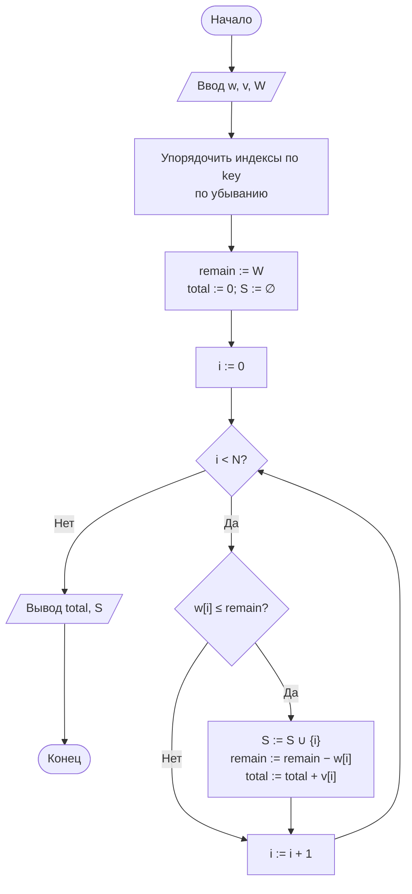
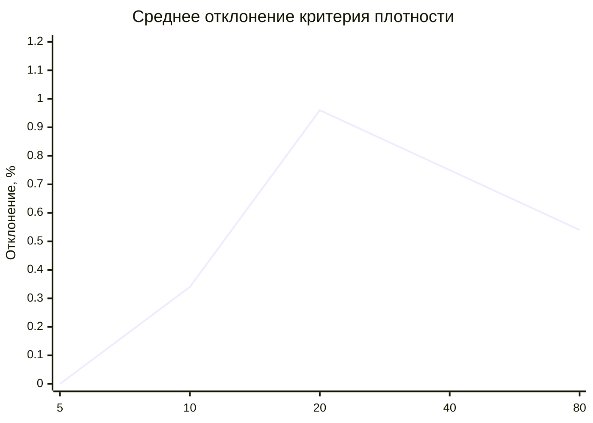
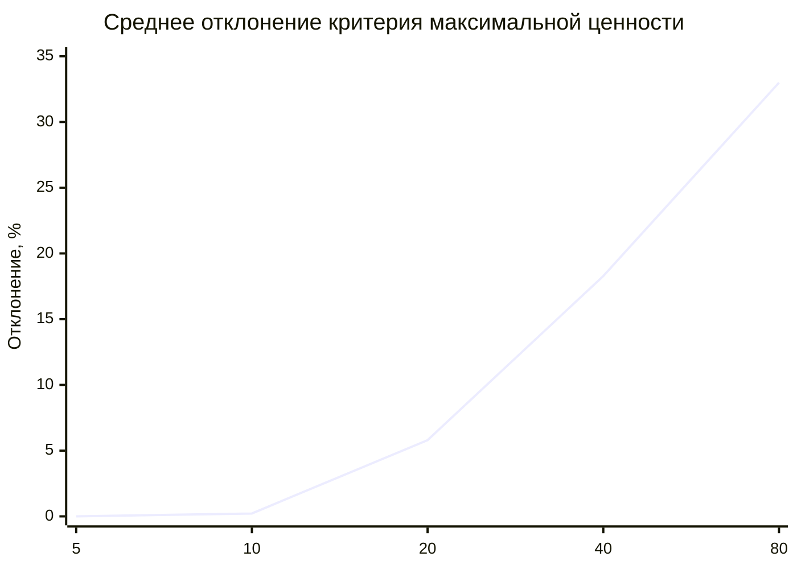

# Лабораторная работа № 8

## Жадные алгоритмы и экспериментальная оценка качества приближённых решений

**Вариант 11**
**Дисциплина:** Теория алгоритмов
**Язык реализации:** Python 3.14

---

## 1. Цель и задание варианта

**Цель:** изучить жадную стратегию, реализовать два жадных критерия для задачи о рюкзаке 0/1 и экспериментально оценить, насколько жадное решение отличается от точного оптимума.

**Исходные данные (табл. 1, вариант 11):**

| Параметр | Значение |
|---|---|
| Задача | Рюкзак 0/1 |
| Жадный критерий 1 | Максимальная удельная ценность $v_i/w_i$ |
| Жадный критерий 2 | Максимальная ценность $v_i$ |
| Размерность | $N = 24$, $W = 200$ |
| Дополнительное задание | Ж4 |

**Дополнительное задание Ж4:** исследовать зависимость среднего отклонения жадного решения от размерности задачи при $N = 5, 10, 20, 40, 80$.

---

## 2. Теоретическая часть

### 2.1. Жадная стратегия

Жадный алгоритм на каждом шаге делает выбор, кажущийся лучшим сейчас, и не пересматривает его. Общая схема:

1. упорядочить предметы по выбранному критерию;
2. просматривать их по порядку;
3. брать предмет, если он ещё помещается в рюкзак.

Трудоёмкость определяется сортировкой — $\Theta(N\log N)$, память — $O(N)$.

### 2.2. Два критерия

**Критерий 1 — удельная ценность.** Предметы сортируются по убыванию $v_i/w_i$. Идея: сначала брать самые «выгодные за килограмм» предметы.

**Критерий 2 — максимальная ценность.** Предметы сортируются по убыванию $v_i$. Идея: сначала брать самые дорогие предметы, не учитывая их вес.

Оба критерия дают допустимое, но не обязательно оптимальное решение, потому что предметы неделимы.

### 2.3. Точное решение — динамическое программирование

Пусть $D[w]$ — максимальная ценность при вместимости $w$. Тогда

$$D[w]=\max\bigl(D[w],\ D[w-w_i]+v_i\bigr).$$

Массив заполняется для каждого предмета в порядке убывания $w$ — так предмет $i$ используется не более одного раза.

Ответ находится в $D[W]$. Трудоёмкость — $\Theta(NW)$, память — $\Theta(W)$.

### 2.4. Оценка качества

Для задач максимизации коэффициент качества равен

$$\rho=\frac{V_{\text{жадн}}}{V_{\text{опт}}}\le 1,$$

а относительное отклонение —

$$\delta=(1-\rho)\cdot100\%.$$

В работе измеряются среднее, медианное и максимальное отклонение, а также доля наборов, где жадное решение совпало с оптимумом.

---

## 3. Блок-схема жадного алгоритма



---

## 4. Листинг программы и пояснение работы кода

Полный код находится в файле [`lab8.py`](lab8.py). Ключевые функции:

```python
def knapsack_dp(weights, values, capacity):
    """Точное решение: максимальная ценность (одномерное ДП)."""
    D = [0] * (capacity + 1)
    for wi, vi in zip(weights, values):
        for w in range(capacity, wi - 1, -1):
            D[w] = max(D[w], D[w - wi] + vi)
    return D[capacity]


def greedy(weights, values, capacity, key):
    """Жадный алгоритм: предметы берутся в порядке убывания key."""
    total, remain, chosen = 0, capacity, []
    for i in sorted(range(len(weights)), key=key, reverse=True):
        if weights[i] <= remain:
            chosen.append(i)
            remain -= weights[i]
            total += values[i]
    return total, sorted(chosen)


def greedy_density(weights, values, capacity):
    return greedy(weights, values, capacity,
                  lambda i: values[i] / weights[i])


def greedy_value(weights, values, capacity):
    return greedy(weights, values, capacity, lambda i: values[i])
```

### 4.1. Как работает программа в целом

1. **`knapsack_dp`** — точный эталон; одномерный массив обновляется в обратном порядке, поэтому каждый предмет учитывается один раз.
2. **`greedy`** — общая жадная процедура: сортирует индексы по ключу и берёт всё, что помещается.
3. **`greedy_density`** — критерий 1, сортировка по $v_i/w_i$.
4. **`greedy_value`** — критерий 2, сортировка по $v_i$.
5. **`experiment`** — на 500 случайных наборах считает отклонение обоих жадных решений от оптимума.
6. **`deviation_by_n`** — задание Ж4: повторяет эксперимент для разных $N$ и усредняет отклонение.
7. В конце замеряется время жадного и точного алгоритмов при росте $N$.

---

## 5. Характеристики вычислительной системы

| Параметр | Значение |
|---|---|
| ОС | macOS 26.4 (Darwin 25.4.0, arm64) |
| Процессор | Apple M5 |
| Оперативная память | 16 ГБ |
| Интерпретатор | Python 3.14.7 |

Методика замера: `time.perf_counter()`, для Ж4 — по 500 случайных наборов на каждое $N$.

---

## 6. Результаты

### 6.1. Контрпример 1 — ошибка критерия удельной ценности

Веса $(6, 5, 5)$, ценности $(12, 9, 9)$, $W = 10$.

| Предмет | Вес | Ценность | $v_i/w_i$ |
|---|---|---|---|
| 1 | 6 | 12 | 2,00 |
| 2 | 5 | 9 | 1,80 |
| 3 | 5 | 9 | 1,80 |

Жадный алгоритм по плотности берёт предмет 1 (ценность 12), после чего остаётся вместимость 4, и больше ничего не помещается. Оптимум — предметы 2 и 3 с ценностью 18 и весом 10. Отклонение:

$$\delta=\frac{18-12}{18}\cdot100\%=33{,}3\%.$$

Критерий максимальной ценности в этом примере тоже выбирает предмет 1 и даёт тот же неверный ответ.

### 6.2. Контрпример 2 — ошибка критерия максимальной ценности

Веса $(9, 6, 4)$, ценности $(10, 7, 6)$, $W = 10$.

| Предмет | Вес | Ценность | $v_i/w_i$ |
|---|---|---|---|
| 1 | 9 | 10 | 1,11 |
| 2 | 6 | 7 | 1,17 |
| 3 | 4 | 6 | 1,50 |

Критерий максимальной ценности берёт предмет 1 (ценность 10), но после него остаётся вместимость 1, и решение равно 10. Критерий плотности берёт предметы 3 и 2: вес $4+6=10$, ценность $6+7=13$ — это оптимум. Отклонение второго критерия:

$$\delta=\frac{13-10}{13}\cdot100\%=23{,}1\%.$$

### 6.3. Серия из 500 случайных наборов

$N = 24$, $W = 200$, веса $w_i\in[5;40]$, ценности $v_i\in[10;100]$.

| Критерий | Среднее отклонение, % | Медиана, % | Максимум, % | Совпало с оптимумом |
|---|---|---|---|---|
| Удельная ценность $v_i/w_i$ | 0,93 | 0,39 | 6,72 | 42,0 % |
| Максимальная ценность $v_i$ | 9,36 | 8,83 | 28,19 | 3,6 % |

Критерий плотности даёт решения, близкие к оптимальным: среднее отклонение меньше 1 %, а в 42 % наборов достигнут точный оптимум. Критерий максимальной ценности проигрывает заметно сильнее: он не учитывает вес и часто заполняет рюкзак тяжёлыми предметами с низкой удельной ценностью.

### 6.4. Задание Ж4 — зависимость отклонения от размерности

$W = 200$, по 500 случайных наборов на каждое $N$.

| $N$ | Плотность: среднее, % | Плотность: максимум, % | Ценность: среднее, % | Ценность: максимум, % |
|---|---|---|---|---|
| 5 | 0,00 | 0,00 | 0,00 | 0,00 |
| 10 | 0,34 | 8,65 | 0,22 | 7,95 |
| 20 | 0,96 | 5,76 | 5,80 | 26,27 |
| 40 | 0,75 | 3,90 | 18,28 | 39,31 |
| 80 | 0,54 | 2,83 | 32,99 | 54,80 |

При $N=5$ все предметы помещаются в рюкзак: максимальный суммарный вес $5\cdot40=200$ не превышает $W$, поэтому оба алгоритма дают точный ответ. Начиная с $N=10$ появляется нехватка вместимости и отклонение становится ненулевым.





Среднее отклонение критерия плотности остаётся в пределах 1 % и не растёт систематически: с увеличением $N$ появляется больше близких по качеству вариантов, поэтому жадный выбор чаще оказывается почти оптимальным. Критерий максимальной ценности, наоборот, деградирует с ростом $N$: при $N=80$ среднее отклонение достигает 33 %, а максимальное — почти 55 %.

### 6.5. Сравнение времени работы

$W = 1000$, случайные веса и ценности.

| $N$ | Жадный, с | ДП, с | ДП медленнее в |
|---|---|---|---|
| 100 | 0,00001 | 0,00293 | 247 |
| 500 | 0,00006 | 0,01483 | 266 |
| 2 000 | 0,00024 | 0,05916 | 249 |
| 5 000 | 0,00062 | 0,14774 | 239 |

Жадный алгоритм работает за $\Theta(N\log N)$ и практически не зависит от $W$, тогда как ДП требует $\Theta(NW)$. При $W=1000$ разрыв составляет около 250 раз. С ростом $W$ точный метод становится ещё дороже, и жадное приближение оказывается единственным практичным вариантом.

---

## 7. Выводы

1. Жадный алгоритм по удельной ценности показал хорошее качество: среднее отклонение 0,93 %, максимальное — 6,72 %, а в 42 % случайных наборов решение совпало с оптимумом. Это ожидаемо: критерий учитывает и ценность, и вес предмета.

2. Критерий максимальной ценности оказался значительно хуже: среднее отклонение 9,36 %, максимальное — 28,19 %, точных совпадений только 3,6 %. Причина в том, что критерий игнорирует вес и может выбрать тяжёлый предмет, после которого рюкзак уже нечем заполнить.

3. Контрпримеры показывают механизм ошибки. В первом случае жадный выбор «самого выгодного за килограмм» предмета оставляет 4 единицы вместимости, которые нельзя использовать. Во втором случае критерий максимальной ценности берёт тяжёлый предмет с ценностью 10 вместо двух предметов с суммарной ценностью 13.

4. Задание Ж4 подтвердило, что качество жадного алгоритма зависит от критерия и размерности. Для плотности отклонение остаётся около 1 % при всех $N$, а для максимальной ценности оно растёт с 0,22 % при $N=10$ до 32,99 % при $N=80$. При $N=5$ оба метода точны, потому что все предметы помещаются в рюкзак.

5. По времени жадный алгоритм примерно в 250 раз быстрее ДП при $W=1000$ и выигрывает тем сильнее, чем больше вместимость. Однако он не даёт гарантии оптимума.

6. Практическая рекомендация: для задачи о рюкзаке 0/1 жадный алгоритм по удельной ценности можно использовать как быстрое приближённое решение при больших $N$ и $W$, но при умеренных размерах, где ДП работает за приемлемое время, точное решение предпочтительнее. Критерий максимальной ценности в качестве основного выбирать не следует.
