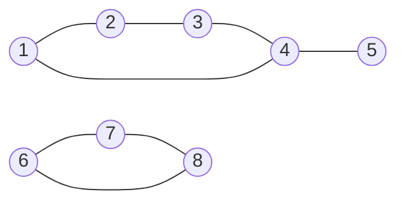
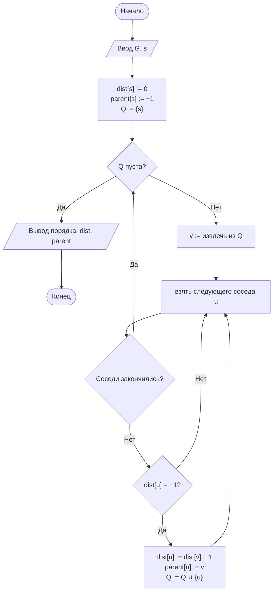
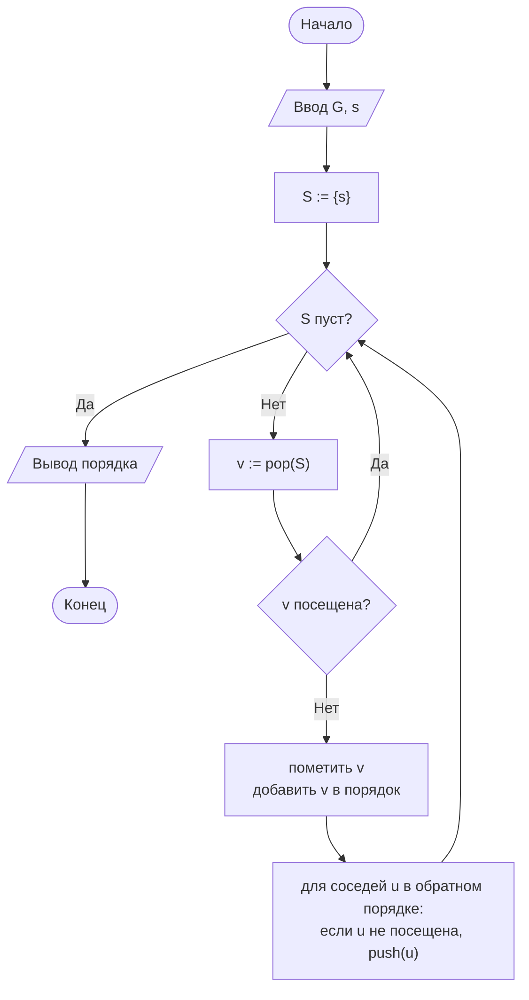
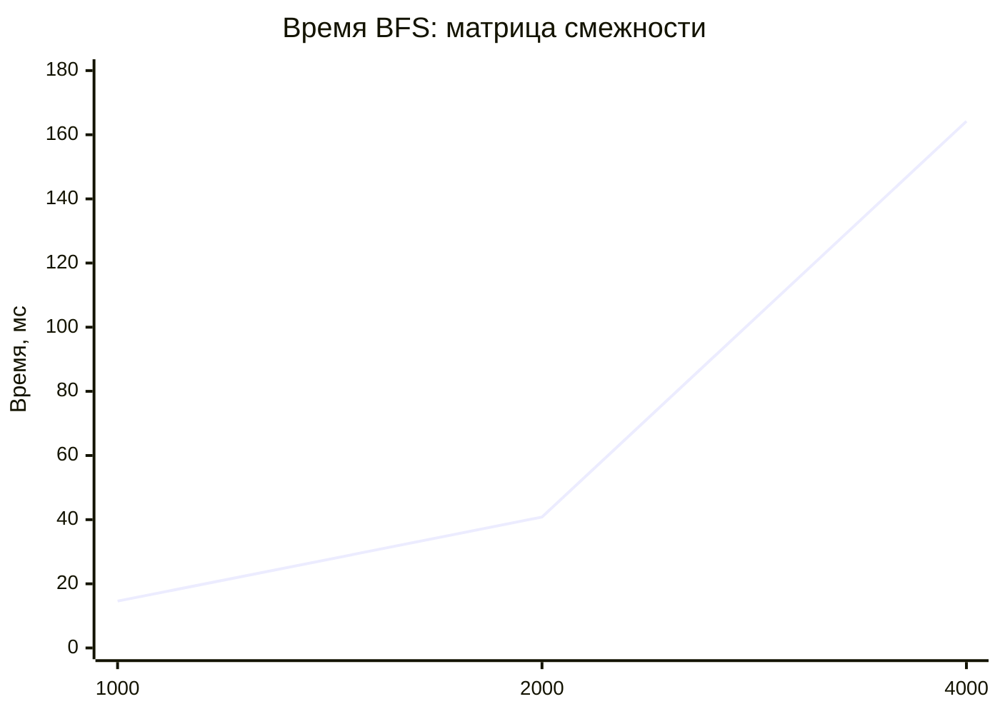
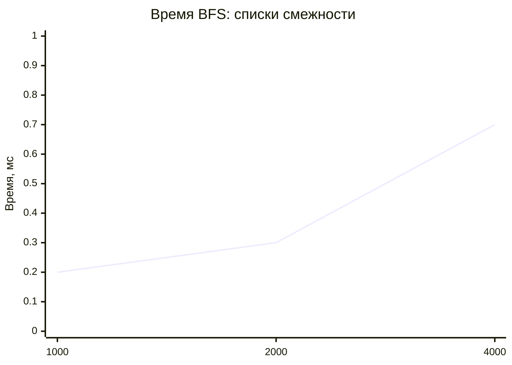

# Лабораторная работа № 9

## Способы представления графов и алгоритмы обхода в ширину и в глубину

**Вариант 11**
**Дисциплина:** Теория алгоритмов
**Язык реализации:** Python 3.14

---

## 1. Цель и задание варианта

**Цель:** изучить матрицу смежности и списки смежности, реализовать BFS и итеративный DFS и экспериментально сравнить представления по времени обхода и расходу памяти.

**Исходные данные (табл. 2, вариант 11):**

| Параметр | Значение |
|---|---|
| Тип графа | Разреженный, $m \approx 3n$ |
| Ориентированность | Неориентированный |
| Размеры $n$ | 1000; 2000; 4000 |
| Задача варианта | Проверка двудольности |
| Дополнительное задание | И4 |

**Задание И4:** реализовать проверку двудольности раскраской в два цвета при BFS и объяснить связь с задачей распределения ресурсов по двум группам.

---

## 2. Теоретическая часть

### 2.1. Представления графа

**Матрица смежности** — квадратная матрица $A$ размера $n\times n$, где $A[i][j]=1$, если есть ребро $(i,j)$. Для неориентированного графа матрица симметрична.

**Списки смежности** — для каждой вершины хранится список её соседей.

| Характеристика | Матрица смежности | Списки смежности |
|---|---|---|
| Память | $\Theta(n^2)$ | $\Theta(n+m)$ |
| Проверка ребра | $\Theta(1)$ | $O(\deg v)$ |
| Перебор соседей | $\Theta(n)$ | $\Theta(\deg v)$ |
| Полный обход | $\Theta(n^2)$ | $\Theta(n+m)$ |

Для разреженного графа $m=O(n)$, поэтому списки дают $\Theta(n)$ памяти и времени, а матрица — $\Theta(n^2)$. Матрица выгодна для плотных графов и частых проверок конкретного ребра.

### 2.2. Обход в ширину

BFS использует очередь. Вершины посещаются в порядке возрастания расстояния от стартовой, поэтому в невзвешенном графе BFS находит кратчайшие пути по числу рёбер. Массив `parent` позволяет восстановить путь.

Трудоёмкость: $\Theta(n+m)$ для списков и $\Theta(n^2)$ для матрицы.

### 2.3. Обход в глубину

DFS идёт вглубь, пока есть непосещённые соседи, а затем возвращается назад. Используется стек. В работе применяется итеративная версия, потому что рекурсивная на графе-цепочке может вызвать `RecursionError`.

Трудоёмкость та же: $\Theta(n+m)$ для списков и $\Theta(n^2)$ для матрицы.

### 2.4. Проверка двудольности

Граф двудольный, если его вершины можно разбить на две доли так, что каждое ребро соединяет вершины из разных долей. Проверка выполняется обходом BFS с раскраской:

- стартовая вершина получает цвет 0;
- соседняя вершина получает цвет $1-\text{цвет текущей}$;
- если сосед уже покрашен в тот же цвет, найдено ребро внутри доли — граф не двудольный.

Если обход завершился без конфликтов, граф двудольный. Это задание И4.

**Связь с распределением ресурсов.** Вершины — объекты, рёбра — конфликты между ними. Двудольность означает, что объекты можно разделить на две группы так, чтобы все конфликты были только между группами. Если граф не двудольный, такого распределения не существует, и конфликт внутри группы неизбежен.

---

## 3. Тестовый граф и результаты обхода



Граф содержит две компоненты: $\{1,2,3,4,5\}$ и $\{6,7,8\}$. Компонента $\{6,7,8\}$ — треугольник, поэтому граф не является двудольным.

**BFS от вершины 1:** порядок $1,2,4,3,5$.

| Вершина | 1 | 2 | 3 | 4 | 5 | 6 | 7 | 8 |
|---|---|---|---|---|---|---|---|---|
| Расстояние | 0 | 1 | 2 | 1 | 2 | −1 | −1 | −1 |
| Предок | — | 1 | 2 | 1 | 4 | — | — | — |

Дерево BFS: $1-2$, $1-4$, $2-3$, $4-5$. Вершины 6–8 недостижимы из вершины 1, поэтому их расстояние равно −1.

**DFS от вершины 1:** порядок $1,2,3,4,5$.

**Проверка двудольности:** весь граф не двудольный, конфликтное ребро $7-8$. Компонента $\{1,2,3,4,5\}$ двудольная.

---

## 4. Блок-схемы BFS и DFS

### 4.1. BFS



### 4.2. DFS



---

## 5. Листинг программы и пояснение работы кода

Полный код находится в файле [`lab9.py`](lab9.py). Ключевые функции:

```python
class MatrixGraph:
    def __init__(self, n):
        self.n = n
        self.matrix = [[0] * n for _ in range(n)]

    def add_edge(self, u, v):
        self.matrix[u][v] = self.matrix[v][u] = 1

    def has_edge(self, u, v):
        return self.matrix[u][v] == 1

    def neighbors(self, v):
        return [u for u in range(self.n) if self.matrix[v][u]]


class ListGraph:
    def __init__(self, n):
        self.n = n
        self.adj = [[] for _ in range(n)]

    def add_edge(self, u, v):
        self.adj[u].append(v)
        self.adj[v].append(u)

    def has_edge(self, u, v):
        return v in self.adj[u]

    def neighbors(self, v):
        return self.adj[v]


def is_bipartite(graph):
    color = [-1] * graph.n
    for start in range(graph.n):
        if color[start] != -1:
            continue
        color[start] = 0
        queue = deque([start])
        while queue:
            v = queue.popleft()
            for u in graph.neighbors(v):
                if color[u] == -1:
                    color[u] = 1 - color[v]
                    queue.append(u)
                elif color[u] == color[v]:
                    return False, color, (v, u)
    return True, color, None
```

### 5.1. Как работает программа в целом

1. **`MatrixGraph`** хранит матрицу $n\times n$; проверка ребра — за $\Theta(1)$, перебор соседей — за $\Theta(n)$.
2. **`ListGraph`** хранит для каждой вершины список соседей; память и перебор соседей пропорциональны степени вершины.
3. **`bfs`** использует `deque`, заполняет порядок обхода, расстояния и массив предков.
4. **`dfs`** использует явный стек и не зависит от глубины рекурсии Python.
5. **`is_bipartite`** запускает BFS из каждой ещё не покрашенной вершины и раскрашивает граф в два цвета. При совпадении цветов возвращает конфликтное ребро.
6. **`generate`** строит случайный разреженный граф с $m=3n$; при `bipartite=True` рёбра добавляются только между чётными и нечётными вершинами, поэтому граф двудольный по построению.
7. **`memory_kb`** считает память под матрицу или списки смежности через `sys.getsizeof`.

---

## 6. Характеристики вычислительной системы

| Параметр | Значение |
|---|---|
| ОС | macOS 26.4 (Darwin 25.4.0, arm64) |
| Процессор | Apple M5 |
| Оперативная память | 16 ГБ |
| Интерпретатор | Python 3.14.7 |

Методика замера: `time.perf_counter()`, время полного BFS из вершины 0. Память — сумма `sys.getsizeof` для матрицы/списков без общих объектов `int`.

---

## 7. Результаты

### 7.1. Время BFS и расход памяти

| $n$ | Тип графа | $m$ | Матрица, с | Списки, с | Матрица, МБ | Списки, МБ | Двудольный |
|---|---|---|---|---|---|---|---|
| 1000 | случайный | 3000 | 0,0146 | 0,0002 | 7,69 | 0,12 | нет |
| 1000 | двудольный | 3000 | 0,0113 | 0,0002 | 7,69 | 0,12 | да |
| 2000 | случайный | 6000 | 0,0408 | 0,0003 | 30,64 | 0,25 | нет |
| 2000 | двудольный | 6000 | 0,0412 | 0,0003 | 30,64 | 0,25 | да |
| 4000 | случайный | 12 000 | 0,1642 | 0,0007 | 122,32 | 0,49 | нет |
| 4000 | двудольный | 12 000 | 0,1649 | 0,0006 | 122,32 | 0,49 | да |

Списки смежности быстрее матрицы в десятки и сотни раз: при $n=1000$ — примерно в 70 раз, при $n=4000$ — более чем в 200 раз. Это соответствует оценкам $\Theta(n+m)$ и $\Theta(n^2)$: для разреженного графа $m=3n$, поэтому списки работают за $\Theta(n)$, а матрица — за $\Theta(n^2)$.





При удвоении $n$ время матрицы растёт примерно в 3–4 раза, то есть стремится к $\Theta(n^2)$. Время списков растёт примерно вдвое, что соответствует $\Theta(n+m)=\Theta(n)$ при $m=3n$.

### 7.2. Расход памяти

| $n$ | Матрица, МБ | Списки, МБ | Во сколько раз матрица больше |
|---|---|---|---|
| 1000 | 7,69 | 0,12 | 64 |
| 2000 | 30,64 | 0,25 | 123 |
| 4000 | 122,32 | 0,49 | 250 |

Матрица занимает $\Theta(n^2)$ памяти независимо от числа рёбер, поэтому при переходе от $n=1000$ к $n=4000$ её размер вырос в 16 раз. Списки выросли только в 4 раза, так как $m=3n$. На разреженном графе при $n=4000$ матрица требует более 120 МБ, а списки — менее 0,5 МБ.

### 7.3. Результат задачи варианта — проверка двудольности

Случайные разреженные графы при $m=3n$ оказались недвудольными: в них с высокой вероятностью есть циклы нечётной длины. Алгоритм находил конфликтное ребро и возвращал `False`.

Графы, построенные с рёбрами только между чётными и нечётными вершинами, оказались двудольными при всех $n$: раскраска BFS завершилась без конфликтов. Это подтверждает корректность алгоритма на обоих типах данных.

Для малого тестового графа конфликтное ребро — $7-8$ в треугольнике $6-7-8$. Компонента $\{1,2,3,4,5\}$ при этом двудольная, то есть проверка корректно работает и для несвязного графа.

---

## 8. Выводы

1. Для разреженных графов списки смежности предпочтительнее матрицы и по времени, и по памяти. При $n=4000$ и $m=3n$ матрица заняла 122 МБ против 0,49 МБ у списков, а BFS работал более чем в 200 раз медленнее. Это прямое подтверждение оценок $\Theta(n^2)$ и $\Theta(n+m)$.

2. Матрица смежности оправдана, когда граф плотный или когда часто требуется проверить наличие конкретного ребра: эта операция у матрицы выполняется за $\Theta(1)$, а у списков — за $O(\deg v)$.

3. BFS и DFS имеют одинаковую асимптотику, но разные области применения. BFS находит кратчайшие пути по числу рёбер и естественно подходит для проверки двудольности, а DFS удобен для поиска циклов, компонент и топологической сортировки.

4. Итеративный DFS предпочтительнее рекурсивного: он не зависит от ограничения глубины стека Python и корректно работает на графах-цепочках большой длины.

5. Проверка двудольности раскраской в два цвета реализована за $\Theta(n+m)$ для списков смежности. Она позволяет не только ответить «да/нет», но и указать конфликтное ребро, если разбиение невозможно.

6. Практическая рекомендация: для большинства прикладных графов (организационные структуры, сети поставок, схемы процессов) следует использовать списки смежности. Матрицу стоит выбирать только для небольших плотных графов или при частых проверках отдельных рёбер.
